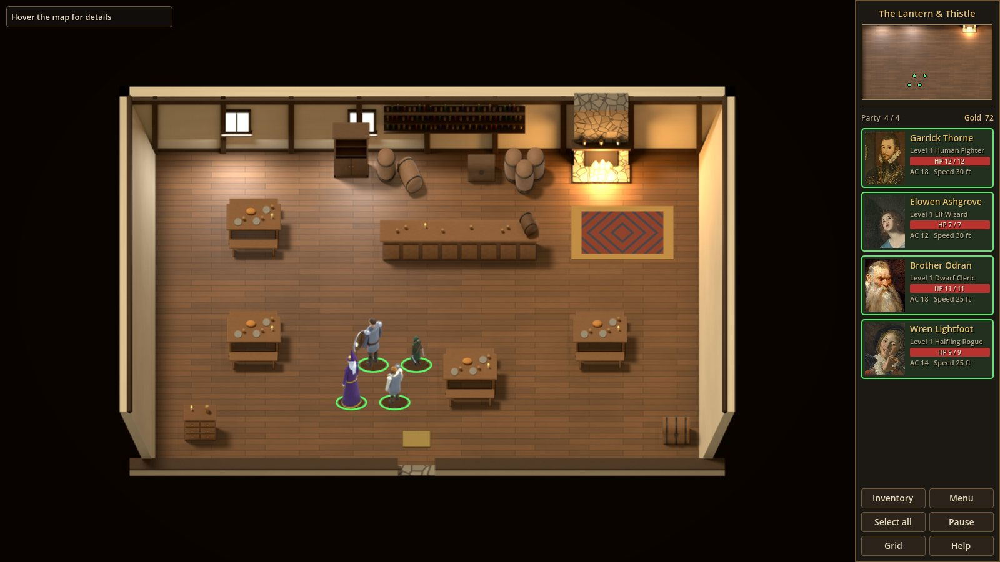

# Lantern's Embrace

A party-based RPG skeleton for **Godot 4.7** (GDScript), in the spirit of the classic
isometric party RPGs: a sidebar of portraits, a party you steer around towns and
wilderness, and everything snapped to a **fixed hex grid**. Exploration is real-time;
combat will switch to turn-based when a fight starts.

The goal of this repository is to be a *core engine*: each system exists in a minimal,
data-driven form you can extend, not a finished game.





New to Godot, or want to know how this is put together before extending it? Start with
**[docs/GODOT_GUIDE.md](docs/GODOT_GUIDE.md)**.

## Status: Phase 2, items and places

### Phase 2: items and places

- **Items:** 33 item types with 5e SRD numbers (weapons, armour, shields, rings, cloaks,
  potions, food, tools, gems, keys), each with a pre-rendered icon. Defined in
  [`data/items/items.json`](data/items/items.json), see [docs/ITEMS.md](docs/ITEMS.md).
- **Inventory and paper doll** (I): ten equipment slots around a large portrait, a 16-slot
  backpack, drag and drop, stacking, and right-click to drink, equip or take off. Armour
  class, attack line, carried weight and speed update live. Drop an item on a sidebar
  portrait to give it to that character.
- **Simplified 5e equipment rules:** armour and shield proficiency, two-handed weapons,
  light weapons for two-weapon fighting, Strength for heavy armour, carrying capacity.
- **Shared party gold**, shown in the sidebar. Coins found in containers go straight into
  the purse.
- **Containers:** chests, drawers, cupboards and a crate of apples, opened on the inventory
  screen with a "Take all" button. Locked ones need their key, or someone with thieves'
  tools to win a lock-picking roll. Contents are remembered.
- **Dropping and picking up items:** the inventory's ground panel shows what lies at the
  character's feet. Dropped items form a pile on the map that stays there (and in saves)
  until picked up.
- **Building interiors as separate maps**, each exactly the size of its building
  (cottages 8×6 hexes, the inn 12×8). Click a building and the party gathers at the door
  and goes in; the way out leads back to the same door. Five pre-rendered rooms (an inn, a
  smithy with a forge, three cottages) with furniture the party walks around.
- **Fog of war:** black where nobody has been, dimmed where the party has been but can't
  see now, with line of sight blocked by buildings. On the minimap too. Off indoors, and
  configurable (`fog_of_war` in the config).
- **Save and load:** an Esc menu with save and load screens (named slots with thumbnails,
  map, date, play time and party), F5 quicksave and F9 quickload. Saves are JSON in
  `user://saves`.
- **Drop-in audio:** music, ambience loops and sound effects requested by name through the
  `Audio` autoload and [`data/audio/audio.json`](data/audio/audio.json), with synthesised
  placeholders. See [docs/AUDIO.md](docs/AUDIO.md).

### Phase 1: movement

- **Hex grid everywhere, invisible on the ground:** pointy-top hexes, axial coordinates,
  A* pathfinding. The ground is painted as one seamless, blended surface, so hexes only
  appear as movement feedback: the hovered target and the path. `G` shows the full grid
  for debugging. Difficult terrain (shallows, brambles) costs double, and paths route
  around it when that's cheaper.
- **Click-to-move like Baldur's Gate:** click a spot, and the click snaps to the hex
  under the cursor. Characters walk in straight lines wherever the ground is clear and
  costs no more, rather than zig-zagging hex to hex, and always stop on a hex centre.
- **Party of up to 4.** The limit is set in config, and members are loaded from
  importable **JSON character sheets** (5e SRD-style numbers).
- **Selection:** click, Shift-click, drag a box, click portraits, number keys,
  Ctrl+A.
- **Group orders:** the leader walks to the clicked hex and the others take the
  nearest free hexes around it, keeping roughly their left/right arrangement. No two
  members ever end on the same hex. Orders can be changed mid-walk.
- **Real-time pause** (Space): you can keep issuing orders while paused.
- **Walk-to-interact:** click a signpost and the leader walks over and reads it.
- **Camera:** WASD/arrows, screen-edge and middle-drag panning; zoom towards the cursor.
- **Minimap** with live party dots and the camera rectangle; click or drag on it to pan.
- **Hover info:** hex coordinates, terrain, move cost, and path length in hexes and feet.
- **Occlusion fade:** trees and buildings turn see-through when someone walks behind them.
- **Buildings sized to their interiors:** each building's footprint is a rectangle of
  hexes (cottage 8×6, inn 12×8), and its interior map uses exactly those dimensions.
- **Sample map** "Millbrook Outskirts" (84×56 hexes): a forest, a river with a wooden
  bridge and a slow ford, and a village square with an inn, four cottages and a well,
  plus a rocky outcrop.
- **Pre-rendered 3D art**, made the way classic isometric RPGs did it: terrain, trees,
  buildings and characters are modelled procedurally in Blender and rendered with Cycles
  by scripts in this repo. Every image is a drop-in replacement (see
  [docs/ASSETS.md](docs/ASSETS.md)).
  - **Painted portraits:** crops of public-domain Old Master paintings, released as CC0
    by The Metropolitan Museum of Art, plus a dozen spare portraits for future NPCs.
  - **Animated characters:** a walk cycle in 8 facings (5 rendered, 3 mirrored), with
    frames advanced by distance walked so feet don't slide.
  - **Animated water:** the river and ford drift and glint.
  - **Variety and set dressing:** several looks per prop type (three oaks, two pines,
    birches, three cottage designs...), plus reeds, ferns, wildflowers, logs, stumps,
    barrels, crates, hay, lamp posts, market stalls and a cart.
  - **Colour grade:** a subtle warm grade and vignette over the game view (`post` in
    `game_config.json`).
- **65 automated tests**, run headless.

## Running it

1. Install **Godot 4.7** (the standard build; .NET is not needed).
2. In the Project Manager, choose **Import** and pick `project.godot` in this folder.
   The first import of the textures takes a few seconds.
3. Press **F5** (or the ▶ button).

## Controls

| Input | Action |
|---|---|
| Left click ground | Move the selected members |
| Left click member / portrait | Select (Shift adds or removes) |
| Left drag | Box select (Shift adds) |
| Right click | Clear selection |
| `1`–`4` | Select a party member (Shift toggles) |
| Ctrl+A | Select the whole party |
| Left click a signpost | Leader walks over and reads it |
| Left click a chest, drawers, cupboard | Leader walks over and opens it |
| Left click a building or a way out | The party gathers at the door and goes through |
| `I` | Inventory (drag to move or equip, right-click to use) |
| Esc | Menu: save, load, quicksave, quickload, quit (also closes windows) |
| F5 / F9 | Quicksave / quickload |
| Double-click a portrait | Centre the camera on that member |
| WASD / arrows / screen edge / middle drag | Pan |
| Mouse wheel, `+` / `-` | Zoom |
| `C` | Centre on the selection |
| Space | Pause / resume |
| `G` | Toggle the debug hex grid |
| F3 | Toggle the hover info panel |
| F1 | Toggle the controls help |

## What to try

- Walk the whole party across the **bridge**, then send them through the **southern ford**
  (the light-blue shallows). They slow down in the water, and the path preview turns amber
  over difficult terrain.
- Send someone diagonally across open grass: they walk straight there, not hex by hex.
- Click deep water or a house: the party goes to the nearest reachable ground instead.
- Select one member (`2`) and send them somewhere, then Shift-click a portrait and move both.
- Walk behind the inn or into the forest to see the occlusion fade.
- Pause with Space, queue up orders, and resume.
- Walk into **The Lantern & Thistle** (the big inn) or any cottage. Inside, open the
  drawers and chests. The **Reeve's strongbox** is locked: find the key in the reeve's
  drawers, or let Wren pick it. The **smithy** has a locked chest too.
- Press **I**, drag a ring onto a ring slot and watch the AC change, or give someone a
  potion by dropping it on their portrait.
- Save with Esc → Save game, change things, and load it back.

All the feel-related numbers are in [`data/config/game_config.json`](data/config/game_config.json):

| Key | Meaning |
|---|---|
| `max_party_size` | Party limit (sidebar and hotkeys adapt) |
| `hex_radius` | Hex size in pixels (centre to corner) |
| `feet_per_hex` | 5e distance per hex (5 ft) |
| `explore_move_speed` | Walking speed in pixels per second |
| `show_grid_default` | Debug grid lines on at start (off: hexes only show for movement) |
| `backpack_slots`, `save_slots` | Backpack size and number of save slots |
| `fog_of_war.*` | Fog on/off, sight radius in hexes, darkness of explored ground |
| `audio_volume_db.*` | Volume per audio bus |
| `terrain_blend.*` | How terrain types blend: weight-map resolution, blur, edge warp and noise |
| `post.*` | Colour grade: contrast, saturation, warmth, vignette (or `enabled: false`) |
| `camera.*` | Pan speed, edge scrolling, zoom limits |

## Project layout

```
assets/            Placeholder art (terrain, props, characters, portraits)
data/
  config/          game_config.json: global tunables
  characters/      Character sheets (JSON), one per file
  party/           starting_party.json: who you start with
  terrain/         terrain.json: terrain types, symbols, movement cost, texture
  props/           props.json: trees, houses, signs, furniture... (sprite, footprint, flags)
  items/           items.json: every item (docs/ITEMS.md)
  audio/           audio.json: sound names -> files (docs/AUDIO.md)
  maps/            The village and five interiors (terrain rows + props), see docs/MAPS.md
docs/              GODOT_GUIDE.md, plus format references (characters, maps, items, assets, audio)
scenes/main.tscn   Entry scene: World + HUD
scripts/
  autoload/        GameConfig, Data (registry), GameState, Events (signal hub), Audio,
                   SaveManager
  core/            Hex math, HexGrid (terrain + A*), JSON helpers
  data/            TerrainDef, PropDef, MapData parsers
  rules/           Rules (5e SRD numbers), CharacterSheet
  items/           ItemDef, ItemStack, Inventory, ContainerState, InventoryOps
  world/           World, TerrainRenderer (+ blend shader), FogOfWar (+ shader),
                   PartyMember, PartyController, Prop, camera, overlays
  ui/              HUD, portrait cards, minimap, inventory screen, item slots, menus, theme
tests/             Headless test runner, unit and integration tests
tools/             make_character.py, art renderers (tools/art/blender), portrait cropper
                   (tools/art/portraits), map generators (tools/maps), sound synthesiser
                   (tools/audio), run_tests.sh
```

### How the pieces fit

- `World` owns one map. It builds a `HexGrid` from a `MapData`, spawns `Prop`s and the
  party (`PartyController` → `PartyMember` tokens), and turns mouse input into orders.
- `TerrainRenderer` paints the ground from the same grid: it bakes terrain weight maps
  from the hexes (with noise so edges are organic) and a shader
  (`terrain_blend.gdshader`) blends the terrain textures in world space.
- `HexGrid` is pure logic: terrain per hex, prop blockers, movement cost and A*. Combat,
  fog of war and AI will query the same grid.
- `Events` is the signal hub, so the world never holds UI references. The HUD listens
  for `selection_changed`, `hover_info_changed`, `message_requested` and so on.
- `GameState` holds the playthrough (party sheets, purse, current map, container contents,
  explored fog) and serialises to a dictionary, which is exactly what a save file holds.
  `SaveManager` writes and reads the slots.
- Items: `ItemDef` is a type from items.json, `ItemStack` a quantity of one, `Inventory` a
  row of slots. `InventoryOps` applies the rules for every move, for the UI and the tests.

[docs/GODOT_GUIDE.md](docs/GODOT_GUIDE.md) walks through all of this in more depth.

## Extending

- **New party member:** run `python3 tools/make_character.py --id ... --class ...` and add
  the id to `data/party/starting_party.json`. See [docs/CHARACTER_SHEETS.md](docs/CHARACTER_SHEETS.md).
- **New map:** copy `data/maps/millbrook_outskirts.json` and edit the text rows, then point
  `starting_map` at it. See [docs/MAPS.md](docs/MAPS.md).
- **New terrain or prop:** add an entry to `data/terrain/terrain.json` or `data/props/props.json`.
- **Real art:** overwrite the PNGs, or change the paths in the JSON. See [docs/ASSETS.md](docs/ASSETS.md).

## Tests

```sh
tools/run_tests.sh /path/to/godot     # or: GODOT=/path/to/godot tools/run_tests.sh
```

This runs `res://tests/test_runner.tscn` headless and exits non-zero on failure. Unit
tests cover hex math, pathfinding, rules, items and equipment rules, armour class, dice,
fog of war, save data round trips, and data validation (every texture and icon exists,
no map has overlapping props, everything interactable is reachable, every interior matches
its building). Integration tests drive the real main scene: group moves, redirects
mid-walk, sign interaction, pause, box select, mouse routing, smoothed walking, going in and
out of a cottage, emptying drawers, keys and lock-picking, the inventory screen, fog
reveal, saving and loading, and quicksave. Any engine or script error raised during a test
fails that test.

## Roadmap

This order follows the plan agreed before Phase 1. See the end of
[docs/GODOT_GUIDE.md](docs/GODOT_GUIDE.md) for how Phases 3 and 4 plug into the code.

1. ~~**Foundation:** hex grid, pathfinding, party selection and movement, camera, minimap, sample map~~
2. ~~**Items and places:** item and equipment data, inventory and paper doll, chests and
   drawers, gold, building interiors as separate maps (door transitions), fog of war,
   save/load with a basic slot menu, and minimal drop-in audio hooks.~~
3. **People:** NPCs, a branching dialogue system (in-house, no addons), quests, vendors
   (buy and sell), temple revival (paid service, game over only when the whole party is down).
4. **Combat:** hostile actions trigger turn-based mode, with initiative, movement and
   actions on hexes. Also weapons and armour, spells and abilities, enemies and AI, death,
   XP and levelling.

Out of scope for now: character creation and cutscenes.

## Credits

See [CREDITS.md](CREDITS.md). Rules numbers come from the 5e System Reference Document
5.1 (CC-BY-4.0). The world art and the sounds were generated for this project by the
scripts in `tools/`; the portraits are CC0 paintings from The Metropolitan Museum of Art.
