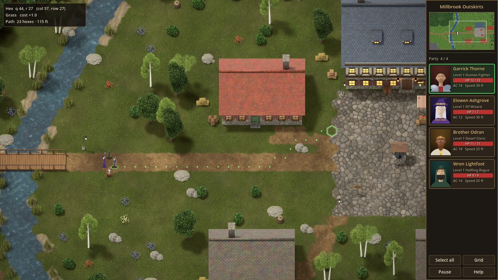
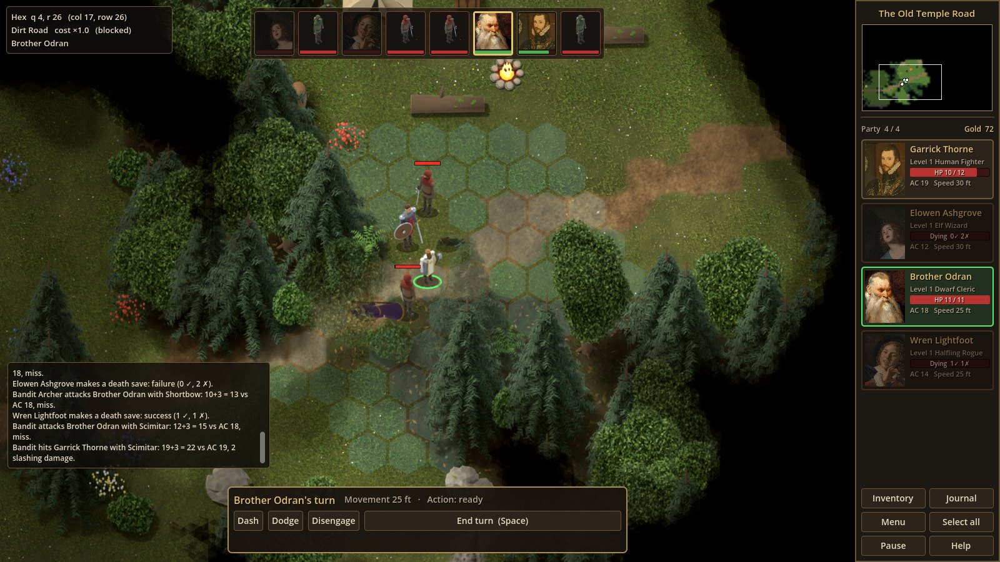
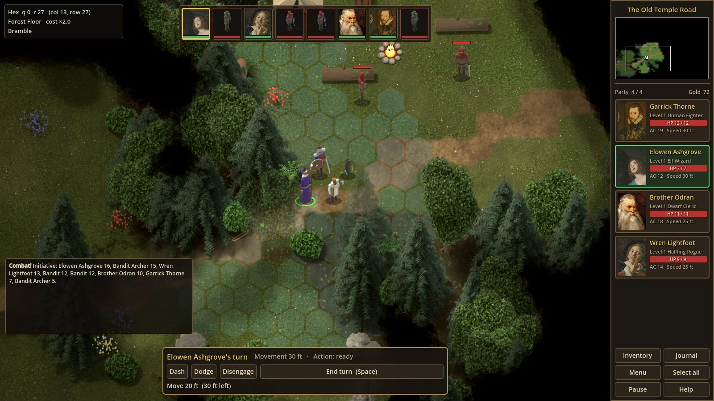
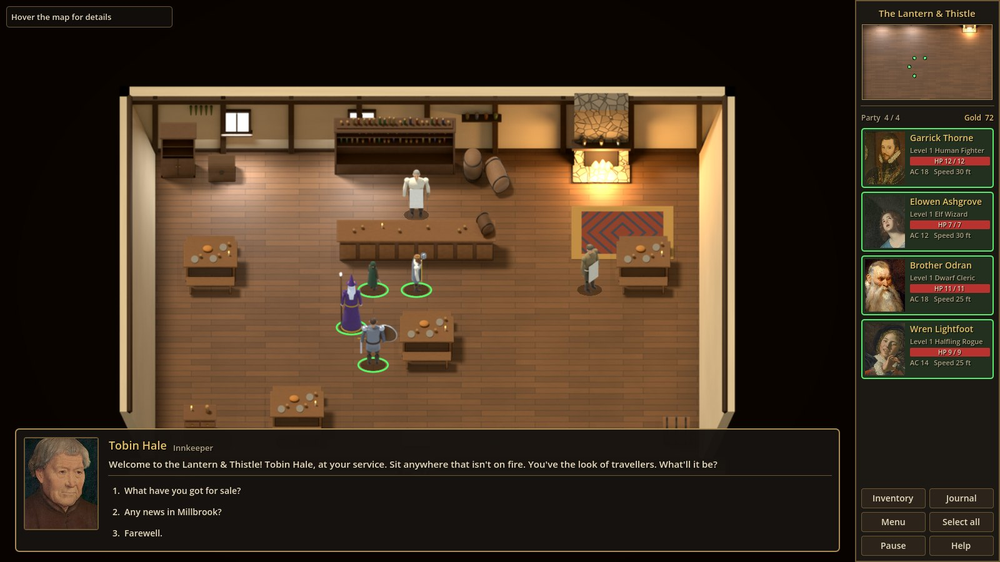
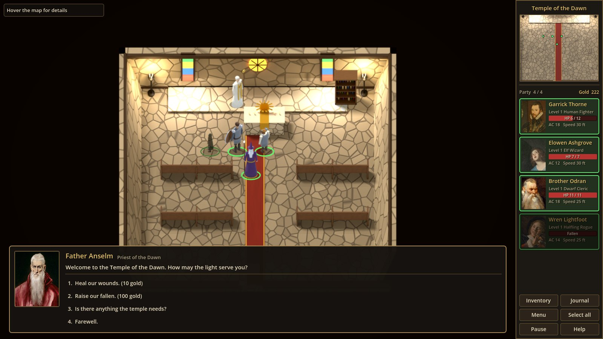
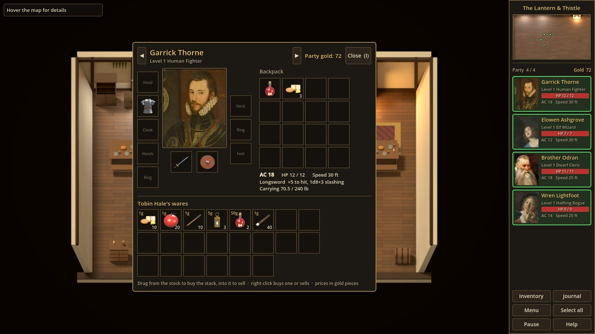
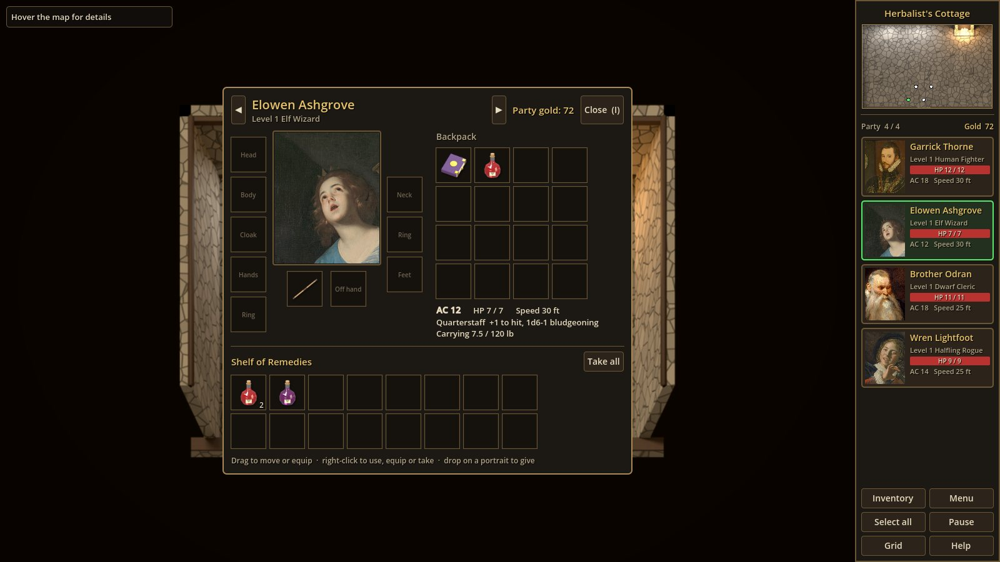
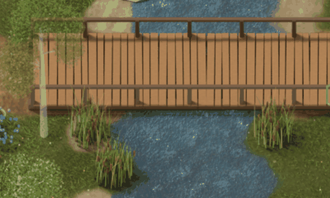

# Lantern's Embrace

A party-based RPG skeleton for **Godot 4.7** (GDScript), in the spirit of the classic
isometric party RPGs: a sidebar of portraits, a party you steer around towns and
wilderness, and everything snapped to a **fixed hex grid**. Exploration is real-time;
combat will switch to turn-based when a fight starts.

The goal of this repository is to be a *core engine*: each system exists in a minimal,
data-driven form you can extend, not a finished game.










New to the project and want to study how it is made? Start with
**[docs/START_HERE.md](docs/START_HERE.md)**, a step-by-step checklist that takes you through
the code and data in order and has a "where do I find..." table. It leans on
**[docs/GODOT_GUIDE.md](docs/GODOT_GUIDE.md)**, which explains how everything works, with
Godot explained along the way.

## Status: Phase 4 (first half), combat

### Phase 4, first half: combat

- **Turn-based fights on the hex grid** (5e, simplified). When creatures see the party
  within their aggro range, everyone rolls initiative and takes turns: movement up to their
  speed (difficult ground costs double), one action (Attack, Dash, Dodge, Disengage, or a
  potion), an off-hand attack as a bonus action with two light weapons, and a reaction for
  opportunity attacks. Click a shaded hex to move, an enemy to attack (stepping up first if
  needed), Space to end the turn. See [docs/COMBAT.md](docs/COMBAT.md).
- **The 5e attack rules:** d20 + bonus against AC, natural 1s and 20s, critical hits,
  advantage and disadvantage (prone, dodging, long range, shooting with an enemy adjacent,
  Pack Tactics), damage vulnerabilities and immunities, ammunition, versatile weapons,
  Sneak Attack, and the Defense fighting style. Hovering an enemy shows the attack and its
  chance to hit.
- **Down, dying and dead:** at 0 HP a party member falls unconscious and makes death saving
  throws on their turns. Any healing gets them up; three failures (or massive damage) and
  only the temple can raise them. The fight is lost only when nobody is left standing.
- **Enemies:** wolves, bandits, bandit archers, skeletons and skeleton archers, from SRD
  stat blocks in [`data/creatures/creatures.json`](data/creatures/creatures.json), with
  rendered, animated sprites. Melee foes close in on the most wounded (wolves hunt as a
  pack); archers keep their distance and shoot.
- **Victory** shares the slain creatures' XP, and they drop their loot on the ground. The
  dead stay dead (in saves too), and beaten groups can complete quests.
- **The combat interface:** an initiative strip along the top, an action bar with movement
  and actions left, a combat log, the reachable hexes shaded, floating damage numbers,
  health bars over enemies, and a few new sounds.
- **New places and quests:** a wolf pack in the woods north-west of Millbrook (Aldous pays a
  bounty), and the **Old Temple Road**, a new map reached from the waymarker at the end of
  the east road, where bandits hold a camp (Bram wants the road open) and skeletons walk
  in a ruined temple (Father Anselm asks you to give them rest).

### Phase 3: people

- **Townsfolk:** seven NPCs with their own rendered, animated sprites and painted portraits:
  an innkeeper behind his bar, a bard, a blacksmith, a herbalist, a miller, the reeve and
  a priest. They stroll near their spots, block the hex they stand on, turn to face you,
  and are hidden in the fog like everything else. Defined in
  [`data/npcs/npcs.json`](data/npcs/npcs.json), see
  [docs/NPCS_AND_QUESTS.md](docs/NPCS_AND_QUESTS.md).
- **Branching dialogue**, in-house (no addons): JSON conversation graphs with conditions
  (flags, quests, items, gold, who's in the party, who's talking, someone hurt or fallen)
  and effects (items, gold, quest stages, XP, healing, raising the fallen). Click someone
  to walk over and talk; pick answers with the mouse or the number keys. See
  [docs/DIALOGUE.md](docs/DIALOGUE.md).
- **Quests and a journal** (J): staged quests whose entries fill the journal, stages that
  advance by themselves (pick up the lost key and the journal notes it), and quest XP for
  every living member, with level-ups and hit points per level. Four quests in Millbrook:
  the reeve's lost key, a fever draught for the miller's wife, a lantern for the temple's
  altar, and a rumour for later.
- **Vendors:** the innkeeper, the blacksmith and the herbalist trade on the inventory
  screen. Drag to buy a stack or right-click to buy one; drag or right-click your own
  items to sell. Each vendor has their own markup and buying rate, and quest items can't
  be sold. What you sell stays on their shelf, in saves too.
- **The Temple of the Dawn**, a new building with its own nave: Father Anselm heals for
  10 gold and raises the fallen for 100. Characters at 0 HP are **fallen** (greyed out,
  can't act). The game is over only when the whole party is down, with a screen to load a
  save. Until combat arrives, Ctrl+K knocks out the selected leader for testing
  (`debug_keys` in the config).
- **Map items:** maps can leave items lying on the ground (the reeve's key by the well),
  which behave exactly like dropped items.
- **Whole buildings in the fog:** once you see any part of a building, all of it shows,
  rather than its roof vanishing into the unexplored dark behind it.

### Phase 2: items and places

- **Items:** 33 item types with 5e SRD numbers (weapons, armour, shields, rings, cloaks,
  potions, food, tools, gems, keys), each with a pre-rendered icon. Defined in
  [`data/items/items.json`](data/items/items.json), see [docs/ITEMS.md](docs/ITEMS.md).
- **Inventory and paper doll** (I): ten equipment slots around a large portrait, a 16-slot
  backpack, drag and drop, stacking, and right-click to drink, equip or take off. Armour
  class, attack line, carried weight and speed update live. Drop an item on a sidebar
  portrait to give it to that character.
- **Simplified 5e equipment rules:** armour and shield proficiency, two-handed weapons,
  light weapons for two-weapon fighting, Strength for heavy armour, carrying capacity.
- **Shared party gold**, shown in the sidebar. Coins found in containers go straight into
  the purse.
- **Containers:** chests, drawers, cupboards and a crate of apples, opened on the inventory
  screen with a "Take all" button. Locked ones need their key, or someone with thieves'
  tools to win a lock-picking roll. Contents are remembered.
- **Dropping and picking up items:** the inventory's ground panel shows what lies at the
  character's feet. Dropped items form a pile on the map that stays there (and in saves)
  until picked up.
- **Building interiors as separate maps**, each exactly the size of its building
  (cottages 8×6 hexes, the inn 12×8, the temple 8×8). Click a building and the party
  gathers at the door and goes in; the way out leads back to the same door. Six
  pre-rendered rooms (an inn with a bar, a smithy with a forge, three cottages, a temple
  nave) with furniture the party walks around. Furnishing add-ons ("bar", "tables:4") lay
  out a tavern in any house.
- **Fog of war:** black where nobody has been, dimmed where the party has been but can't
  see now, with line of sight blocked by buildings. On the minimap too. Off indoors, and
  configurable (`fog_of_war` in the config).
- **Save and load:** an Esc menu with save and load screens (named slots with thumbnails,
  map, date, play time and party), F5 quicksave and F9 quickload. Saves are JSON in
  `user://saves`.
- **Drop-in audio:** music, ambience loops and sound effects requested by name through the
  `Audio` autoload and [`data/audio/audio.json`](data/audio/audio.json), with synthesised
  placeholders. See [docs/AUDIO.md](docs/AUDIO.md).

### Phase 1: movement

- **Hex grid everywhere, invisible on the ground:** pointy-top hexes, axial coordinates,
  A* pathfinding. The ground is painted as one seamless, blended surface, so hexes only
  appear as movement feedback: the hovered target and the path. `G` shows the full grid
  for debugging. Difficult terrain (shallows, brambles) costs double, and paths route
  around it when that's cheaper.
- **Click-to-move like Baldur's Gate:** click a spot, and the click snaps to the hex
  under the cursor. Characters walk in straight lines wherever the ground is clear and
  costs no more, rather than zig-zagging hex to hex, and always stop on a hex centre.
- **Party of up to 4.** The limit is set in config, and members are loaded from
  importable **JSON character sheets** (5e SRD-style numbers).
- **Selection:** click, Shift-click, drag a box, click portraits, number keys,
  Ctrl+A.
- **Group orders:** the leader walks to the clicked hex and the others take the
  nearest free hexes around it, keeping roughly their left/right arrangement. No two
  members ever end on the same hex. Orders can be changed mid-walk.
- **Real-time pause** (Space): you can keep issuing orders while paused.
- **Walk-to-interact:** click a signpost and the leader walks over and reads it.
- **Camera:** WASD/arrows, screen-edge and middle-drag panning; zoom towards the cursor.
- **Minimap** with live party dots and the camera rectangle; click or drag on it to pan.
- **Hover info:** hex coordinates, terrain, move cost, and path length in hexes and feet.
- **Occlusion fade:** trees and buildings turn see-through when someone walks behind them.
- **Buildings sized to their interiors:** each building's footprint is a rectangle of
  hexes (cottage 8×6, inn 12×8), and its interior map uses exactly those dimensions.
- **Sample map** "Millbrook Outskirts" (84×56 hexes): a forest, a river with a wooden
  bridge and a slow ford, and a village square with an inn, four cottages and a well,
  plus a rocky outcrop.
- **Pre-rendered 3D art**, made the way classic isometric RPGs did it: terrain, trees,
  buildings and characters are modelled procedurally in Blender and rendered with Cycles
  by scripts in this repo. Every image is a drop-in replacement (see
  [docs/ASSETS.md](docs/ASSETS.md)).
  - **Painted portraits:** crops of public-domain Old Master paintings, released as CC0
    by The Metropolitan Museum of Art, plus a dozen spare portraits for future NPCs.
  - **Animated characters:** a walk cycle in 8 facings (5 rendered, 3 mirrored), with
    frames advanced by distance walked so feet don't slide.
  - **Animated water:** the river and ford drift and glint.
  - **Variety and set dressing:** several looks per prop type (three oaks, two pines,
    birches, three cottage designs...), plus reeds, ferns, wildflowers, logs, stumps,
    barrels, crates, hay, lamp posts, market stalls and a cart.
  - **Colour grade:** a subtle warm grade and vignette over the game view (`post` in
    `game_config.json`).
- **65 automated tests**, run headless.

## Running it

1. Install **Godot 4.7** (the standard build; .NET is not needed).
2. In the Project Manager, choose **Import** and pick `project.godot` in this folder.
   The first import of the textures takes a few seconds.
3. Press **F5** (or the ▶ button).

## Controls

| Input | Action |
|---|---|
| Left click ground | Move the selected members |
| Left click member / portrait | Select (Shift adds or removes) |
| Left drag | Box select (Shift adds) |
| Right click | Clear selection |
| `1`–`4` | Select a party member (Shift toggles) |
| Ctrl+A | Select the whole party |
| Left click a signpost | Leader walks over and reads it |
| Left click a chest, drawers, cupboard | Leader walks over and opens it |
| Left click a building or a way out | The party gathers at the door and goes through |
| Left click a person | Leader walks over and talks to them |
| Left click a creature | Start a fight |
| In a fight: left click ground / an enemy | Move within the shaded area / attack (stepping up first if needed) |
| In a fight: Space | End the turn |
| `1`–`9` in a conversation | Pick an answer (or click it) |
| `I` | Inventory (drag to move or equip, right-click to use) |
| `J` | Journal: quests and XP |
| Esc | Menu: save, load, quicksave, quickload, quit (also closes windows) |
| F5 / F9 | Quicksave / quickload |
| Double-click a portrait | Centre the camera on that member |
| WASD / arrows / screen edge / middle drag | Pan |
| Mouse wheel, `+` / `-` | Zoom |
| `C` | Centre on the selection |
| Space | Pause / resume |
| `G` | Toggle the debug hex grid |
| F3 | Toggle the hover info panel |
| F1 | Toggle the controls help |
| Ctrl+K / Ctrl+Shift+K | Debug: knock out / kill the selected leader (with `debug_keys` on) |

## What to try

- Walk the whole party across the **bridge**, then send them through the **southern ford**
  (the light-blue shallows). They slow down in the water, and the path preview turns amber
  over difficult terrain.
- Send someone diagonally across open grass: they walk straight there, not hex by hex.
- Click deep water or a house: the party goes to the nearest reachable ground instead.
- Select one member (`2`) and send them somewhere, then Shift-click a portrait and move both.
- Walk behind the inn or into the forest to see the occlusion fade.
- Pause with Space, queue up orders, and resume.
- Walk into **The Lantern & Thistle** (the big inn) or any cottage. Inside, open the
  drawers and chests. The **Reeve's strongbox** is locked: let Wren pick it, or find the
  reeve's key. The **smithy** has a locked chest too.
- Talk to **Aldous**, the reeve, by the well. His key lies on the cobbles nearby. Give
  it back for 40 gold and 150 XP, or keep it and open his strongbox.
- Talk to **Wenna** the herbalist (south-west cottage) and take her draught to **Hob**
  the miller (west of the square).
- Visit **Father Anselm** at the temple (up the lane north-east of the square) and ask
  what the temple needs. **Tobin** at the inn sells the lantern.
- Party members have their own lines: Anselm and Wenna know Odran, Bram talks shop with
  Garrick, and Pip's song means something to Elowen.
- Press Ctrl+K to knock someone out and give them a potion, or Ctrl+Shift+K to kill them
  and pay the temple to raise them. Knock out everyone to see the game-over screen.
- Cross the bridge and head into the **north-west woods** to meet the wolves. Let Garrick
  hold the line and Wren flank for Sneak Attack, and watch for wolves knocking people prone.
- Take the **waymarker at the end of the east road** to the Old Temple Road. Rest at
  Tobin's first. The bandits' archers keep their distance; the skeletons at the ruin fear
  Odran's mace (bludgeoning).
- Press **I**, drag a ring onto a ring slot and watch the AC change, or give someone a
  potion by dropping it on their portrait.
- Save with Esc → Save game, change things, and load it back.

All the feel-related numbers are in [`data/config/game_config.json`](data/config/game_config.json):

| Key | Meaning |
|---|---|
| `max_party_size` | Party limit (sidebar and hotkeys adapt) |
| `hex_radius` | Hex size in pixels (centre to corner) |
| `feet_per_hex` | 5e distance per hex (5 ft) |
| `explore_move_speed` | Walking speed in pixels per second |
| `show_grid_default` | Debug grid lines on at start (off: hexes only show for movement) |
| `backpack_slots`, `save_slots` | Backpack size and number of save slots |
| `fog_of_war.*` | Fog on/off, sight radius in hexes, darkness of explored ground |
| `audio_volume_db.*` | Volume per audio bus |
| `terrain_blend.*` | How terrain types blend: weight-map resolution, blur, edge warp and noise |
| `post.*` | Colour grade: contrast, saturation, warmth, vignette (or `enabled: false`) |
| `camera.*` | Pan speed, edge scrolling, zoom limits |

## Project layout

```
assets/            Placeholder art (terrain, props, characters, portraits)
data/
  config/          game_config.json: global tunables
  characters/      Character sheets (JSON), one per file
  party/           starting_party.json: who you start with
  terrain/         terrain.json: terrain types, symbols, movement cost, texture
  props/           props.json: trees, houses, signs, furniture... (sprite, footprint, flags)
  items/           items.json: every item (docs/ITEMS.md)
  audio/           audio.json: sound names -> files (docs/AUDIO.md)
  maps/            The village, the Old Temple Road and six interiors (terrain rows, props,
                   townsfolk, creatures), see docs/MAPS.md
  npcs/            npcs.json: townsfolk, their sprites, dialogue and shops (docs/NPCS_AND_QUESTS.md)
  creatures/       creatures.json: hostile creatures' stat blocks (docs/COMBAT.md)
  dialogue/        One conversation graph per speaker (docs/DIALOGUE.md)
  quests/          quests.json: quest stages, journal entries and XP
docs/              START_HERE.md (study checklist), GODOT_GUIDE.md, plus format references
                   (maps, items, characters, dialogue, NPCs and quests, combat, assets, audio)
scenes/main.tscn   Entry scene: World + HUD
scripts/
  autoload/        GameConfig, Data (registry), GameState, Events (signal hub), Audio,
                   SaveManager
  core/            Hex math, HexGrid (terrain + A*), JSON helpers
  data/            TerrainDef, PropDef, MapData parsers
  rules/           Rules (5e SRD numbers), CharacterSheet
  items/           ItemDef, ItemStack, Inventory, ContainerState, InventoryOps (incl. buy/sell)
  dialogue/        Dialogue, DialogueRunner, Conditions, Effects
  quests/          QuestDef
  npc/             NpcDef, Npc
  combat/          CombatManager, CombatAI, CombatRules, Combatant, Attack, CreatureDef,
                   CreatureSheet
  world/           World, TerrainRenderer (+ blend shader), FogOfWar (+ shader), Actor,
                   PartyMember, PartyController, Creature, Prop, camera, overlays
  ui/              HUD, portrait cards, minimap, inventory/shop screen, item slots,
                   dialogue window, journal, combat HUD, menus, theme
tests/             Headless test runner, unit and integration tests
tools/             make_character.py, art renderers (tools/art/blender), portrait cropper
                   (tools/art/portraits), map generators (tools/maps), sound synthesiser
                   (tools/audio), run_tests.sh
```

### How the pieces fit

- `World` owns one map. It builds a `HexGrid` from a `MapData`, spawns `Prop`s and the
  party (`PartyController` → `PartyMember` tokens), and turns mouse input into orders.
- `TerrainRenderer` paints the ground from the same grid: it bakes terrain weight maps
  from the hexes (with noise so edges are organic) and a shader
  (`terrain_blend.gdshader`) blends the terrain textures in world space.
- `HexGrid` is pure logic: terrain per hex, prop blockers, movement cost and A*. Combat,
  fog of war and AI will query the same grid.
- `Events` is the signal hub, so the world never holds UI references. The HUD listens
  for `selection_changed`, `hover_info_changed`, `message_requested` and so on.
- `GameState` holds the playthrough (party sheets, purse, current map, container contents,
  explored fog, quests, story flags) and serialises to a dictionary, which is exactly what
  a save file holds. `SaveManager` writes and reads the slots.
- People: `Npc` and `PartyMember` share the `Actor` base (sprite, facing, walking). A
  conversation is a `DialogueRunner` (pure logic) shown by the `DialogueWindow`.
- Fights: `CombatManager` runs the turn loop as a coroutine, `CombatRules` does the dice,
  and `CombatAI` plays the creatures. A `CreatureSheet` is a `CharacterSheet`, so monsters
  and the party share hit points, armour class, saves and damage.
- Items: `ItemDef` is a type from items.json, `ItemStack` a quantity of one, `Inventory` a
  row of slots. `InventoryOps` applies the rules for every move, for the UI and the tests.

[docs/GODOT_GUIDE.md](docs/GODOT_GUIDE.md) walks through all of this in more depth.

## Extending

- **New party member:** run `python3 tools/make_character.py --id ... --class ...` and add
  the id to `data/party/starting_party.json`. See [docs/CHARACTER_SHEETS.md](docs/CHARACTER_SHEETS.md).
- **New map:** copy `data/maps/millbrook_outskirts.json` and edit the text rows, then point
  `starting_map` at it. See [docs/MAPS.md](docs/MAPS.md).
- **New townsperson, conversation or quest:** an entry in `data/npcs/npcs.json`, a file in
  `data/dialogue/`, a stage list in `data/quests/quests.json`, and `{"id", "at"}` in a
  map's `"npcs"`. See [docs/NPCS_AND_QUESTS.md](docs/NPCS_AND_QUESTS.md).
- **New terrain or prop:** add an entry to `data/terrain/terrain.json` or `data/props/props.json`.
- **Real art:** overwrite the PNGs, or change the paths in the JSON. See [docs/ASSETS.md](docs/ASSETS.md).

## Tests

```sh
tools/run_tests.sh /path/to/godot     # or: GODOT=/path/to/godot tools/run_tests.sh
```

This runs `res://tests/test_runner.tscn` headless and exits non-zero on failure. Unit
tests cover hex math, pathfinding, rules, items and equipment rules, armour class, dice,
fog of war, save data round trips, and data validation (every texture and icon exists,
no map has overlapping props, everything interactable is reachable, every interior matches
its building). Integration tests drive the real main scene: group moves, redirects
mid-walk, sign interaction, pause, box select, mouse routing, smoothed walking, going in and
out of a cottage, emptying drawers, keys and lock-picking, the inventory screen, fog
reveal, saving and loading, and quicksave. Phase 3 adds tests for every condition and
effect, whole conversations and quests played through the dialogue runner, XP and
levelling, buying and selling, the temple's healing and raising, defeat, and checks that
every dialogue link, item and quest reference is valid. In the running game it checks
that every NPC can be reached, walking up to the innkeeper and shopping, the key by the
well, entering the temple, the journal and the game-over screen. Phase 4 adds the combat
arithmetic (weapon attacks, hit chances, critical hits, damage types, death saves,
movement range) and fights on the real map: noticing the party, movement limits,
attacking, Dash, Dodge and Disengage, opportunity attacks, the wolf and archer AI, victory
with XP and loot, death saves, potions mid-fight, defeat, and the road to the old temple.
Any engine or script error raised during a test fails that test.

## Roadmap

This order follows the plan agreed before Phase 1. See the end of
[docs/GODOT_GUIDE.md](docs/GODOT_GUIDE.md) for how Phases 3 and 4 were added and where the rest of Phase 4
plugs into the code.

1. ~~**Foundation:** hex grid, pathfinding, party selection and movement, camera, minimap, sample map~~
2. ~~**Items and places:** item and equipment data, inventory and paper doll, chests and
   drawers, gold, building interiors as separate maps (door transitions), fog of war,
   save/load with a basic slot menu, and minimal drop-in audio hooks.~~
3. ~~**People:** NPCs, a branching dialogue system (in-house, no addons), quests, vendors
   (buy and sell), temple revival (paid service, game over only when the whole party is down).~~
4. **Combat:** hostile actions trigger turn-based mode, with initiative, movement and
   actions on hexes. Also weapons and armour, spells and abilities, enemies and AI, death,
   XP and levelling.
   - ~~First half: turns, movement, attacks, enemies and AI, XP from fights, death saves.~~
   - Second half: spells and cantrips, spell slots, spell scrolls, resting, class features.

Out of scope for now: character creation and cutscenes.

## Credits

See [CREDITS.md](CREDITS.md). Rules numbers come from the 5e System Reference Document
5.1 (CC-BY-4.0). The world art and the sounds were generated for this project by the
scripts in `tools/`; the portraits are CC0 paintings from The Metropolitan Museum of Art.
