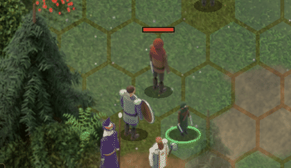
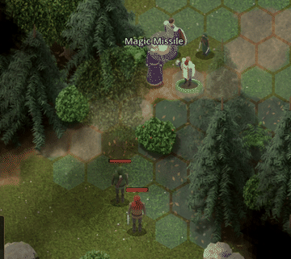
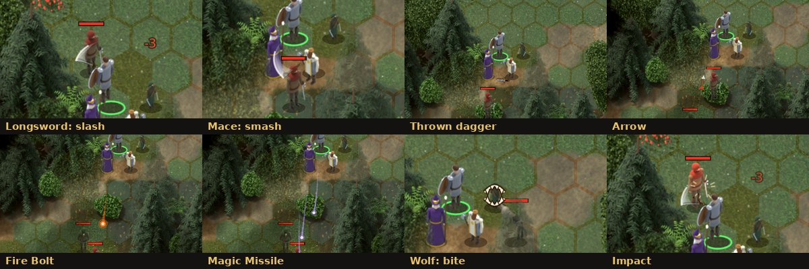

# Combat effects: how attacks look

A sample set of attack animations to build on. Melee attacks swing the weapon, ranged
attacks shoot something, and spells fly in their own colour. They are drawn in Godot as 2D
effects around the existing character sprites (nothing was re-rendered), with the
characters' bodies moving through each beat.






## The three beats

Every attack plays in three beats, all starting from the attacker's own figure:

| Beat | Melee | Bow or thrown weapon | Spell |
|---|---|---|---|
| **1. Wind-up** | Lean back and crouch a little (a mace also rises) | Lean back to draw | A small rise, and a glow swells at the staff or hand |
| **2. Release** | Lunge forward; a swing smear sweeps from the shoulder towards the target | A small recoil; the arrow (or the spinning weapon) leaves the hand and flies on an arc | The bolt (or darts) leaves the glow |
| **3. Impact** | Hit: sparks, a flash, and the target flinches away (bigger on a critical hit; a mace adds a dust ring). Miss: the target sidesteps | Hit: as melee. Miss: the shot flies past and lands in a puff of dust | Sparks in the spell's colour, a flash and a flinch |

The rules don't wait for the animation, and it doesn't change them. `CombatManager.attack_with`
rolls first (hit or miss, critical, damage), then calls `CombatFx.play_attack` with the
result. When that returns, the blow has landed, and only then does the damage number appear
and the log line get written. Magic Missile applies each dart's damage as that dart
arrives (each dart is its own hit in 5e, so a concentrating caster also saves once per dart).

The arms don't move: the sprites only have idle and walk frames. The body motion (lean,
lunge, flinch) and the smear starting at the shoulder make the attack read as the
character's own. The weapon built into the sprite stays where it is, so the swing is
drawn as a motion smear with the equipped weapon's icon faint at its edge, rather than a
solid second weapon. Rendered strike frames would close that gap; see
[Adding strike frames later](#adding-strike-frames-later).

## The effects

All in `scripts/combat/fx/`, each a `Node2D` that draws itself with `_draw()`, tweens its
own `progress` from 0 to 1 and frees itself at the end.

| Class | Styles | What it draws |
|---|---|---|
| `SwingFx` | `slash`, `smash`, `thrust`, `punch`, `bite`, `claw` | A crescent swept around the shoulder (slash: sideways past the aim; smash: from overhead down onto the target), a jab (thrust, punch), or marks drawn on the target (jaws closing; three raking lines). The weapon's inventory icon rides the leading edge, half transparent. |
| `ProjectileFx` | `arrow`, `thrown`, `bolt`, `dart` | An arrow (shaft, head, red fletching), the thrown weapon's icon spinning, a glowing bolt with a trail, or a small dart with a long trail. |
| `BurstFx` | `hit`, `charge`, `dust` | A flash and a spray of sparks; a glow swelling before a spell; a flattened ring on the ground. |

`scripts/combat/combat_fx.gd` (**CombatFx**) is the director: it picks the style, moves the
bodies and places the effects.

### The maths, briefly

- **The swing smear** is a polygon. For each of 18 steps from its tail to its leading edge
  it takes a point on a circle of the swing's radius (the outer edge) and a point a little
  inside it (the inner edge). The gap between the two edges grows with the square of the
  distance along the smear, so it is thick at the leading edge and thin behind. Each
  vertex gets its own transparency, so the tail fades out. As `progress` goes from 0 to 1
  the leading edge's angle moves from the start of the sweep to its end, and the tail
  follows 60% of the sweep behind. The circle is squashed to 82% of its height, because
  the ground is seen from 45° above.
- **Which way it turns.** A slash sweeps from 1.25 radians before the aim to 1.0 after it,
  turning clockwise when the target is to the right and anticlockwise when it is to the
  left, so the blade always crosses the body. A smash starts straight up and ends just
  past the aim. Going from one angle to another "the shortest way round" would sometimes
  swing a mace over the wrong shoulder, so the end angle is unwrapped (2π added or
  taken away) until going from start to end turns the chosen way.
- **Projectile paths** are quadratic Bézier curves: from the start towards a control point
  and on to the end. The point a fraction `t` of the way along is
  `start.lerp(control, t).lerp(control.lerp(end, t), t)`. Lifting the control point above
  the midpoint makes an arc (10% of the distance for arrows, 22% for a thrown dagger).
  Pushing it sideways bends the path: Magic Missile's darts are pushed 34 px apart, so
  they fan out and meet at the target.
- **Flight time** is distance ÷ speed (arrows 900 px/s, thrown weapons 620, bolts 720,
  darts 560), never under about a tenth of a second.
- **Trails** remember the last few positions and draw lines between them that get thinner
  and fainter towards the oldest.

## Where the hands are: anchors

So that swings start at the shoulder and arrows leave the bow, each character's sprite
sheet description (`assets/characters/<name>_anim.json`) lists **anchors**. For each of
the five rendered facings (S, SE, E, NE, N) there is the pixel offset from the feet of:

| Anchor | Where |
|---|---|
| `weapon` | The weapon hand (sword, staff, mace) |
| `off` | The other hand (shield, off-hand dagger, and an archer's bow) |
| `focus` | Where spells leave from: the wizard's staff crystal; for others, the weapon hand |
| `head` | The head (the swing's pivot is 45% of the way from the hand to the head, about the shoulder) |
| `center` | The middle of the figure's outline (where blows and spells land) |

They come from the same 3D models as the sprites. `tools/art/blender/export_anchors.py`
builds each model in its idle pose for each facing, finds the hand, crystal and head
objects, and projects their 3D positions through the sprite camera (45° down, 64 px per
hex) to pixels from the feet. It writes them into the JSON without re-rendering anything,
in under a minute. `render_characters.py` writes them too whenever it renders a sheet.

In the game, `Actor.anchor("weapon")` returns the anchor as a world position for the
facing the actor has now. The three mirrored facings (SW, W, NW) flip it left to right,
and it follows the sprite while it lunges. A sprite without anchors (a static image) gets
rough guesses from its size.

## Changing how an attack looks

The defaults come from the attack itself (`CombatFx.style_for`):

| Attack | Effect |
|---|---|
| A slashing weapon (longsword, greataxe, scimitar) | `slash` (two-handed: a wider arc; light: a shorter one) |
| A bludgeoning weapon (mace, warhammer) | `smash` |
| A piercing melee weapon (dagger, rapier, shortsword) | `thrust` |
| No weapon | `punch` |
| A creature attack named Bite or Claw | `bite`, `claw` |
| A bow | `arrow` (party: from the weapon hand; creatures: from the bow hand) |
| A thrown weapon | `thrown`, from the hand it was in |
| A spell attack | `bolt` in its damage type's colour (fire orange, radiant gold, force violet, cold blue...) |

An `"fx"` block in the data overrides any of it:

```json
// data/items/items.json: a weapon's "weapon" block
"weapon": {"damage": "1d6", "damage_type": "bludgeoning", "fx": {"swing": "slash"}}

// data/creatures/creatures.json: one of a creature's attacks
{"name": "Bite", "damage": "2d4+2", "damage_type": "piercing", "fx": {"swing": "bite"}}

// data/spells/spells.json: a spell
"fx": {"kind": "darts", "color": "#b49aff"}
```

| Key | Values |
|---|---|
| `swing` | `slash`, `smash`, `thrust`, `punch`, `bite`, `claw` |
| `kind` | For ranged weapons: `arrow`. For spells: `bolt` or `darts` |
| `color` | Any colour, `"#rrggbb"`: the smear's colour, or the bolt's |

The quarterstaff (a sweeping `slash` instead of a `smash`), the wolf's bite and the four
attack spells use these.

## Adding an effect

Say you want a sling stone, a small grey ball on a high arc.

1. **Draw it.** In `ProjectileFx._draw()`, add a branch to the `match kind:`:
   `"stone": draw_circle(p, 3.0, Color(0.5, 0.5, 0.5, fade))`.
2. **Use it.** In `data/items/items.json`, give the sling's `weapon` block
   `"fx": {"kind": "stone"}`.
3. **Shoot it.** In `CombatFx.play_attack`, send `"stone"` to `_shoot` with the others
   (`"arrow", "thrown", "stone":`), and in `_shoot` give it its own arc (say 30% of the
   distance).

A new melee style is the same in `SwingFx` (a branch in `_draw()` and a drawing function).
A new kind of beat, such as a spell that lands as a pillar of light on the target, is a new
function in `CombatFx` alongside `_strike`, `_shoot` and `_cast_bolt`: wind up, `await
m.pause(...)`, spawn the effect, `await` until it lands, then `_impact`. After every `await`,
check `_can_play()`: a game may have been loaded in the meantime.

## Timing and pausing

- Every wait is `m.pause(seconds)`, a combat timer that stops while the game is paused (the
  Esc menu), and the effect nodes are `PROCESS_MODE_PAUSABLE`, so a blow freezes mid-swing
  and carries on.
- With `combat.animate = false` (the tests) nothing is drawn and nothing waits, so fights
  in tests still resolve in a few frames.
- If a game is loaded while a blow is playing out, the fight it belonged to is gone:
  `_can_play()` turns false, the effect stops, and `attack_with` returns without dealing
  damage (see the generation guard in [SPELLS.md](SPELLS.md)).
- The effects live on the World's `fx` layer (`world.fx`), above the characters and under
  the fog of war, and are cleared when a map is unloaded.

## Adding strike frames later

If the smear and the lunge aren't enough, the next step is a wind-up and a strike pose
rendered for each character (two extra columns in each sprite sheet: arm back, arm
extended). They would plug in here without other changes:

1. `render_characters.py`: a `POSE["attack"]` value (0 = rest, 1 = wind-up, 2 = strike)
   that raises and extends the weapon arm in `body()`, and two more columns in
   `frames()`. The JSON gains `"attack_columns": [9, 10]`.
2. `Actor`: a `pose_frame(column)` that shows a column for the current facing and puts the
   idle frame back afterwards.
3. `CombatFx._strike`: show the wind-up column during the wind-up beat and the strike
   column during the release.

The swing would still show the weapon built into each model, not the equipped one; making
it the equipped one means drawing weapons as separate sprites on top of the figures.

## Testing

`tests/unit/test_combat_fx.gd` checks the style picked for every party weapon, creature
attack and spell, the data overrides, and that every sprite sheet has all five anchors for
each facing. `tests/integration/test_spells.gd` plays a real swing and a Magic Missile with
animation on, checking that the damage waits for the blow, every dart lands and the effects
free themselves. It also checks that loading a game mid-swing stops the old blow without
damage, and that anchors follow the facing (mirrored for west).

To look at the effects closely, `tests/tools/fx_capture.tscn` plays each one in a real fight
and saves every frame to `tests/output/fx/`, with the game slowed to 0.15× so even a slow
renderer catches every beat. It needs a display; on a server, use `xvfb-run`:

```
xvfb-run -a godot --path . --rendering-driver opengl3 res://tests/tools/fx_capture.tscn
python3 tools/capture/fx_gifs.py   # the GIFs and the strip in docs/images/
```
