# The painted art style

The inventory icons come in two looks:

- **classic**, the original renders: clean, smooth, rather like plastic toys.
- **painted**, re-modelled items rendered so they look hand-painted, the way icons in
  fantasy RPGs usually do: worn edges, dirt in the cracks, warm light, brushy colour and
  an inked outline.

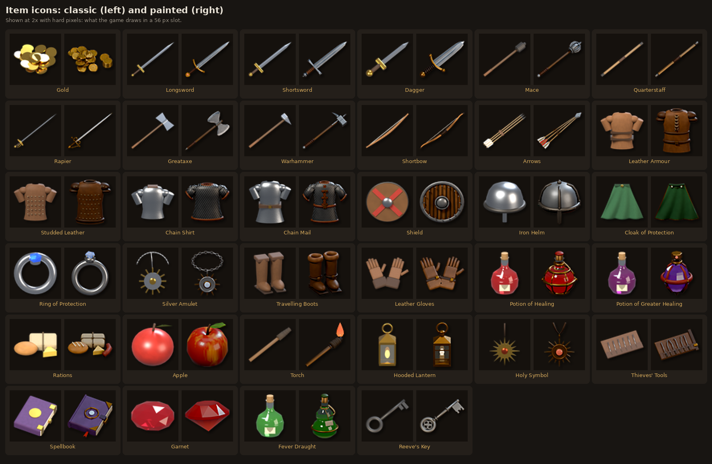

This document explains how to switch between the two, then how the painted look is made,
one step at a time, including the maths, in words a newcomer can follow. It also records
how each setting was arrived at, mistakes included, so you can carry on tuning it yourself.

**Contents**

1. [Switching between the styles](#1-switching-between-the-styles)
2. [What we were aiming for](#2-what-we-were-aiming-for)
3. [A short primer: the ideas everything is built from](#3-a-short-primer)
4. [The recipe, step by step, on one shield](#4-the-recipe-step-by-step)
5. [The materials, one by one](#5-the-materials-one-by-one)
6. [The models: what the painted versions add](#6-the-models)
7. [How the settings were chosen](#7-how-the-settings-were-chosen)
8. [Tuning knobs](#8-tuning-knobs)
9. [Adding or changing an icon](#9-adding-or-changing-an-icon)
10. [Why only the icons (for now)](#10-why-only-the-icons-for-now)
11. [Limits](#11-limits)
12. [Files, and how to remake every picture here](#12-files-and-how-to-remake-every-picture-here)

---

## 1. Switching between the styles

### The setting

In [`data/config/game_config.json`](../data/config/game_config.json):

```json
"art_style": {
	"items": "painted"
},
```

| Value | Shows |
|---|---|
| `"painted"` | the icons in `assets/items/painted/` (the default) |
| `"classic"` | the original icons in `assets/items/` |

The game reads this when it starts. A misspelt value is reported as a warning and the
classic icons are used.

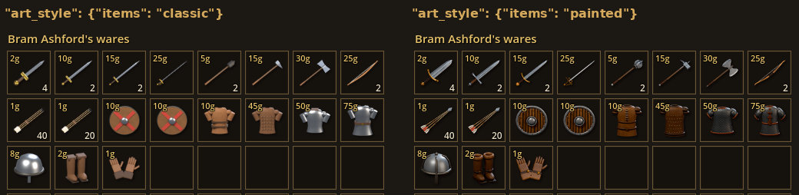

### In the game

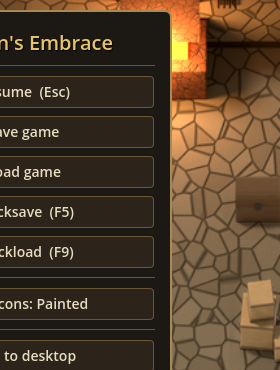

The **Esc** menu has a button, **Item icons: Painted**. Clicking it switches every icon at
once (inventory, equipment, shops, containers) and the button then reads
**Item icons: Classic**. It lasts until you quit. The JSON setting decides how the game
starts, so the menu is for comparing the two looks quickly.

<br clear="right">

### How it works

Nothing in the item data changes. `data/items/items.json` still names the classic file:

```json
"longsword": { ..., "icon": "res://assets/items/longsword.png", ... }
```

When the game loads an item's icon it passes that path through one function,
`GameConfig.styled_path()` in [`scripts/autoload/game_config.gd`](../scripts/autoload/game_config.gd):

1. The **kind** of art is the first folder under `res://assets/`. Here it is `items`.
2. Look up that kind's style in `art_style`. Kinds not listed are `classic`.
3. If it's `classic`, use the path as it is.
4. Otherwise look for the same file name in a subfolder named after the style:
   `res://assets/items/painted/longsword.png`.
5. **If that file doesn't exist, fall back to the classic one.** You can add a new item
   with only a classic icon and nothing breaks.

`Data.set_art_style("items", "classic")` ([`scripts/autoload/data_registry.gd`](../scripts/autoload/data_registry.gd))
does the switch while the game runs. It reloads every item's icon through `styled_path()`
and emits the `Events.art_style_changed` signal, which makes each inventory slot
(`ItemSlot`) redraw itself. The menu button calls it.

The rule doesn't mention items anywhere, so it works for any kind of art. If characters or
props are ever rendered in the painted style, their files go into
`assets/characters/painted/` or `assets/props/painted/` and the setting gets a
`"characters": "painted"` line. Only items have painted art today (see
[section 10](#10-why-only-the-icons-for-now)). A new style name, `"watercolour"` say,
would be added to `GameConfig.ART_STYLES` and given its own folders.

`tests/unit/test_art_style.gd` checks five things:
- the setting is valid;
- the path rule, including the fallback;
- every item has an icon in both styles;
- switching swaps the loaded textures and tells the UI;
- an unknown style is refused.

### Where the files are

| | Classic | Painted |
|---|---|---|
| Icons (64×64 PNG) | `assets/items/<name>.png` | `assets/items/painted/<name>.png` |
| Made by | `tools/art/blender/render_items.py` | `tools/art/blender/render_items_painted.py` |
| Look (materials, lights) | `render_items.py` and `lib.material()` | `tools/art/blender/painted.py` |
| Finishing pass | a soft drop shadow | `tools/art/blender/paint_filter.py`, then the same shadow |

Rendering, from the repository folder (the Blender setup is in [ASSETS.md](ASSETS.md)):

```sh
.venv-art/bin/python tools/art/blender/render_all.py items                        # both styles
.venv-art/bin/python tools/art/blender/render_all.py --style painted items        # painted only
.venv-art/bin/python tools/art/blender/render_all.py --style painted items:mace   # one icon
```

After rendering, open the project in the Godot editor once (or run
`godot --headless --path . --import`) so Godot imports the new PNGs.

---

## 2. What we were aiming for

The project owner shared a sheet of painted fantasy item art: swords, shields, potions,
robes and armour. It isn't in the repository, since we don't own it. Comparing it with the
classic icons gave this list of differences:

| The painted references have... | The classic icons had... |
|---|---|
| Bright, chipped edges where paint and dirt have worn off | Even colour everywhere |
| Dark grime in cracks, seams and where parts meet | Clean surfaces |
| Lighting a painter would choose: warm light, cool rims, a top-to-bottom fall-off | A neutral studio light, with highlights that burn out to pure white |
| Visible material: wood grain, mail rings, leather stitching, scratches | Smooth colour with a little noise |
| Shapes with detail: fullers, wrapped grips, rivets, buckles | Simple shapes (a box for a guard, a sphere for a pommel) |
| Flat strokes of colour and a dark outline | Smooth CG shading and no outline |

A human painter gets these effects by hand. We don't have a painter, and hand-painted
icons couldn't be re-rendered when an item changes. So the approach is to **keep the 3D
models and imitate the painter's habits** in three layers:

1. **Materials** that know where an object would be worn and where it would be dirty.
2. **Lighting** arranged the way a painter would light it.
3. **A finishing pass** on the rendered picture that flattens colour into strokes and
   inks an outline.

The models were rebuilt with more detail too, because a painted look on a plain box still
looks like a box.

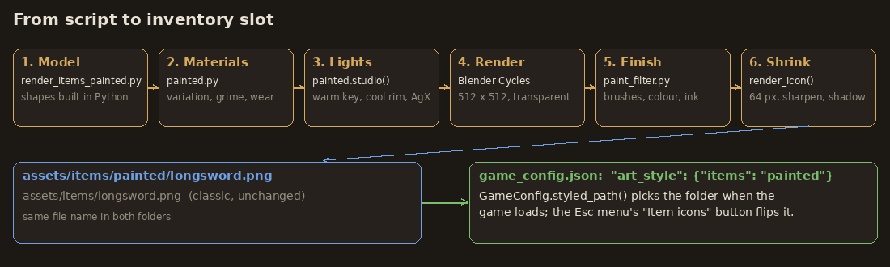

---

## 3. A short primer

You need only a handful of ideas to follow the rest. If you know 3D rendering, skip ahead.

**Rendering.** Blender builds a scene (models, lights, a camera) and its renderer, Cycles,
traces rays of light to make a picture. We drive Blender from Python scripts (`import bpy`)
rather than clicking in its window, so every icon can be remade by running a script.

**Materials and shader nodes.** A material says what a surface looks like. In Blender it's
a small network of **nodes**, boxes wired together, each doing one job: "make a noise
pattern", "multiply these", "mix these colours". Everything ends in one node, the
**Principled BSDF**, which takes, among other things:
- a **Base Color** (the paint colour);
- a **Roughness**: 0 is a mirror, 1 is chalk;
- a **Metallic** value: 0 is paint, wood or cloth, 1 is bare metal.

`painted.py` builds these networks in code, one `nt.nodes.new(...)` per box.

**Colours are numbers.** Each colour is three numbers from 0 to 1 (red, green, blue). Hex
codes like `#8f959d` are the same numbers written 0 to 255. Blender works in *linear*
light, so `lib.lin()` converts the hex colours we write into linear values. You don't need
to think about this beyond "always go through `lib.lin`".

**Masks.** A mask is a black-and-white picture: 0 (black) means "not here", 1 (white) means
"here", and greys mean "partly". The painted look is mostly masks: "where is it worn",
"where is it dirty".

**Normals.** Every point on a surface has a **normal**, an arrow sticking straight out of
it. Lighting depends on which way the normals point.

**Dot product.** For two arrows of length 1, the dot product is the cosine of the angle
between them:
- 1 if they point the same way;
- 0 if they are at right angles;
- −1 if they are opposite.

So `1 − dot(a, b)` is 0 when two arrows agree and grows as they part. That one fact finds
the worn edges in step 5.

**Noise.** A noise texture gives a smooth, random value between 0 and 1 at every point,
like clouds. Its **scale** sets how big the blobs are: scale 3 gives a few broad blobs
across an object, scale 40 gives fine speckle. Noise makes things look uneven and
handmade.

**Coordinates.** A texture needs to know where on the object a point is. *Object*
coordinates are positions on the model, in metres. *Generated* coordinates are the same
positions squashed into 0 to 1 across the object's bounding box, so Generated Z is 0 at
the object's bottom and 1 at its top.

**Map Range and Mix.** Nearly everything is built from these two operations:

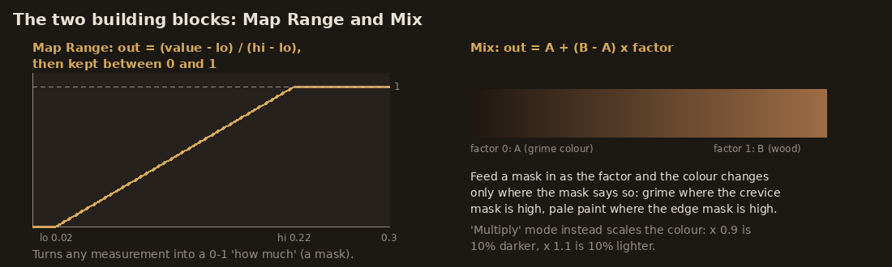

- **Map Range** stretches a value from one range into another and clips it:
  `out = (value − lo) / (hi − lo)`, kept between 0 and 1. It turns any measurement into a
  mask.
- **Mix** blends two colours by a factor: `out = A + (B − A) × factor`. Factor 0 gives A,
  1 gives B, 0.5 halfway. With a mask as the factor, a colour changes only where the mask
  says. In *Multiply* mode, Mix instead scales a colour, so × 0.9 is 10% darker.

---

## 4. The recipe, step by step

Here is the shield taken through the recipe one step at a time. Every picture is a real
render made by `tools/art/blender/painted_breakdown.py`, which sets a switch
(`painted.PREVIEW`) to stop the recipe early or show one mask on its own.

| | | |
|:-:|:-:|:-:|
| 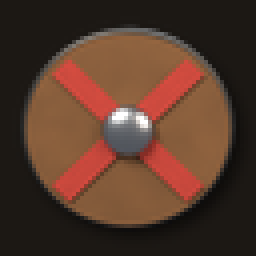 | 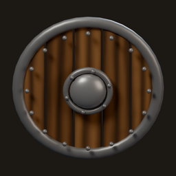 |  |
| **0. Classic icon** (64 px, enlarged) | **1. New model, flat colours** | **2. + colour variation and gradient** |
| 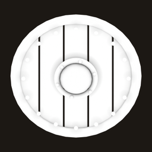 | 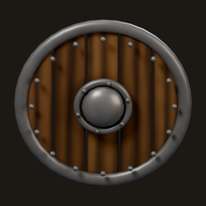 | 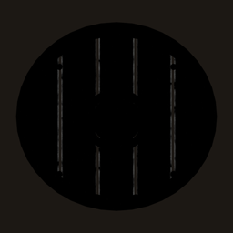 |
| **3. The crevice mask** | **4. + grime in the crevices** | **5. The worn-edge mask** |
| 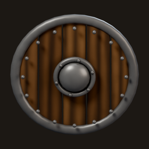 | 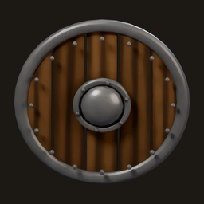 | 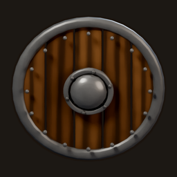 |
| **6. + worn edges: the full material** | **8. + brushwork** | **9. + colour and outline** |

And the result at the size the game shows it:

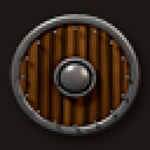

The common recipe is one function, `_painted()` in [`painted.py`](../tools/art/blender/painted.py).
Each material in section 5 calls it with its own colours and amounts and adds its own
pattern on top.

### Step 1: a better model, flat colours

Before any painting, the model itself changed. The classic shield was a disc with a red
cross. The painted one is five separate planks, each a slightly different brown, sitting
at slightly different depths. It has a steel rim, 16 rivets, a domed boss on a riveted
flange, and wood grain running along each plank. See section 6 for what the other models
gained.

### Step 2: colour variation and a top-to-bottom gradient

Paint is never perfectly even. The base colour is multiplied by three things:

```
colour = base
       × MapRange(noise(scale 3),  0..1  →  1 − var .. 1 + var)              broad, soft variation
       × MapRange(noise(scale 14), 0.25..0.75 → 1 − 0.8·var .. 1 + 0.5·var)  smaller smudges
       × MapRange(Generated Z,     0..1  →  0.78 .. 1.12)                    darker below, lighter above
```

`var` is 0.12 by default, so the broad variation moves the colour up to 12% either way.
The last line copies a painter's habit: objects are lit from above, so their lower parts
are a little darker (×0.78 at the bottom, ×1.12 at the top). Look at the shield's lower
planks in picture 2.

### Step 3: the crevice mask (ambient occlusion)

The **Ambient Occlusion** node asks, at each point: of all the directions you could look
from here, what fraction are open, not blocked by nearby geometry within `ao_dist` (4 cm)?

- Out in the open the answer is 1 (white).
- In a crack, at the foot of a rivet, or between two planks, much of the view is blocked
  and the value drops towards 0 (dark).

That is exactly where dirt collects and where a painter darkens. The mask is picture 3.

### Step 4: grime

```
colour = Mix(dark, colour, MapRange(cavity, 0..1 → 1 − grime .. 1))
```

The factor is 1 out in the open, which leaves the colour unchanged. In the deepest crease
it falls to `1 − grime`. With `grime = 0.85` the colour there becomes 85% of the way to the
grime colour `dark` (a darker shade of the base, `_shade(colour, 0.3)` for wood). Picture 4
shows the planks' seams and the base of each rivet darkened.

### Step 5: the worn-edge mask

This is the step that makes things look handled, and the one that looks the most
mysterious in the code (`edge_mask()`).

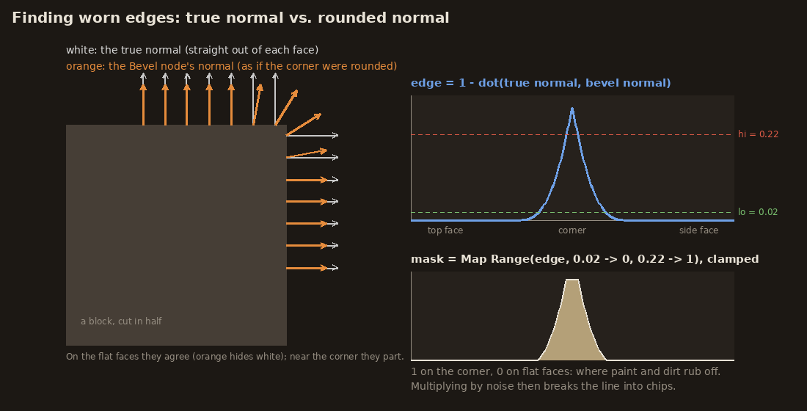

The **Bevel** shader node returns the normal the surface *would* have if its corners were
rounded off, by averaging the normals of nearby surface within a small radius (6 mm here).
It is used for shading only; the geometry doesn't change.

- On a flat face the true normal and the rounded one agree, so their dot product is 1.
- Near a corner they disagree.

So:

```
edge = 1 − dot(bevel normal, true normal)         0 on flat faces, larger near edges
edge = MapRange(edge, 0.02 → 0, 0.22 → 1)         ignore tiny curvature, saturate on real edges
edge = edge × MapRange(noise(scale 38), 0.5 − 0.5·chip .. 0.5 + 0.2·chip → 0..1)
```

- The **0.02** threshold makes gentle curves (a rounded boss, a smooth handle) count as
  "not an edge".
- The **0.22** threshold makes any real corner count fully.

The diagram works the numbers through for a square corner: the rounded normal leans 45°
there, `1 − cos 45° = 0.29`, which is above 0.22, so the mask is 1 on the corner.

The last line multiplies by noise, so the wear comes out as chips and scuffs rather than a
neat line. `chip` (0.55 for metal, 0.3 for wood) sets how broken up it is. Picture 5 is
this mask. It is white only along the planks' edges. The rim, the boss and the rivets are
smooth, rounded shapes with no corners, so they get no wear, which is what you'd expect
from the maths. To give a part wear, give it real corners: a bevel modifier, a box, or a
flat face.

### Step 6: worn edges

```
colour    = Mix(colour, edge colour, edge × edge_strength)
roughness = Mix(rough, rough − 0.25, edge)
```

Worn edges get a pale colour: bare steel, raw wood, scuffed leather. They are also made
smoother (less rough), because handling polishes them. Picture 6 is the full material, as
Blender renders it.

### Step 7: the lights

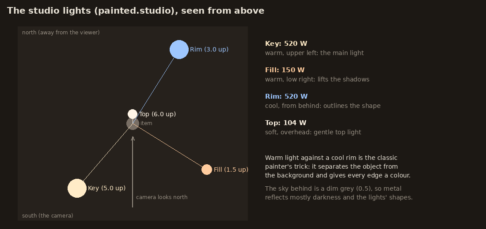

`painted.studio()` sets four lights:

| Light | Position | Colour | Strength | Job |
|---|---|---|---|---|
| Key | above, front left | warm white | 520 W | the main light, from the upper left like all the game's art |
| Fill | low, front right | warm | 150 W | keeps the shadows from going black |
| Rim | behind, right | cool blue | 520 W | draws a cool edge around the silhouette |
| Top | straight above | soft white | 104 W | the gentle top-down light painters use |

Painters set warm light against cool shadow and rim light so an object stands out from its
background. The classic rig had a stronger key (900 W) and a brighter grey sky.

**The view transform (AgX).** Cycles calculates light as plain numbers, and something has
to turn them into screen colours. The classic icons used *Standard*, which cuts every
value above 1.0 to pure white. The painted icons use **AgX** with the *Punchy* look, which
rolls bright values off gently and lets very bright colours fade towards white instead of
turning flat yellow or white:

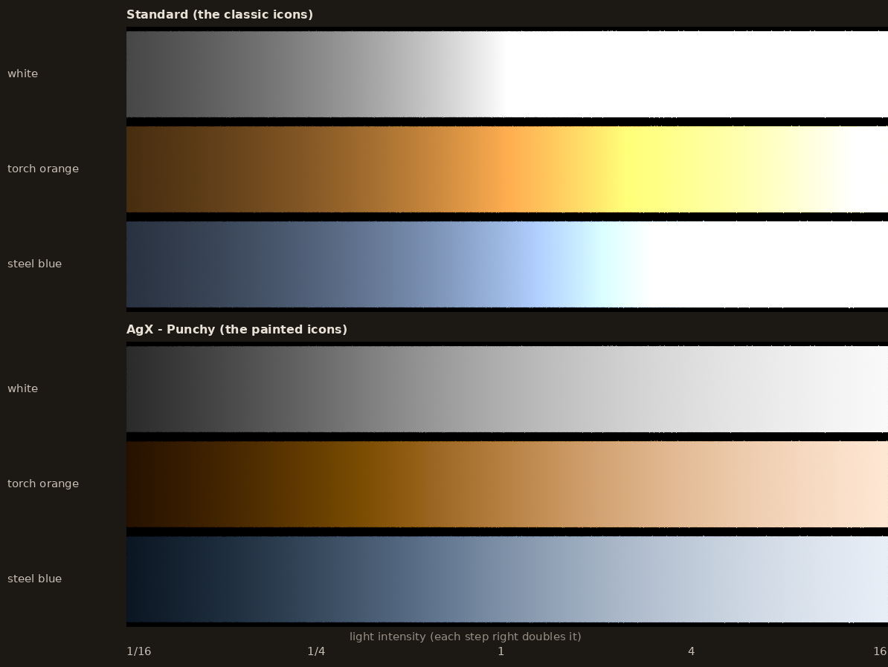

Each strip runs from 1/16 to 16 times "white" light, doubling at each step.
- **Standard:** everything right of the middle is the same flat white. Orange torchlight
  turns yellow, then white; steel blue turns cyan, then white.
- **AgX:** the brights keep a gradient all the way, and colours never swing to a different
  hue: they fade gently towards white. It also shows "white" (1.0) as a light grey, so the
  same lights look darker under AgX; the painted rig was balanced for that.

This matters for metal, whose highlights are very bright. Under Standard the classic steel
was blown out to flat white.

Here is the shield with the same materials and lights, but Standard instead of AgX:

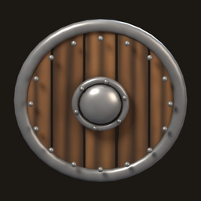

### Step 8: brushwork (the Kuwahara filter)

The rest happens to the rendered picture (512×512), not in Blender. The code is in
[`paint_filter.py`](../tools/art/blender/paint_filter.py), plain numpy.

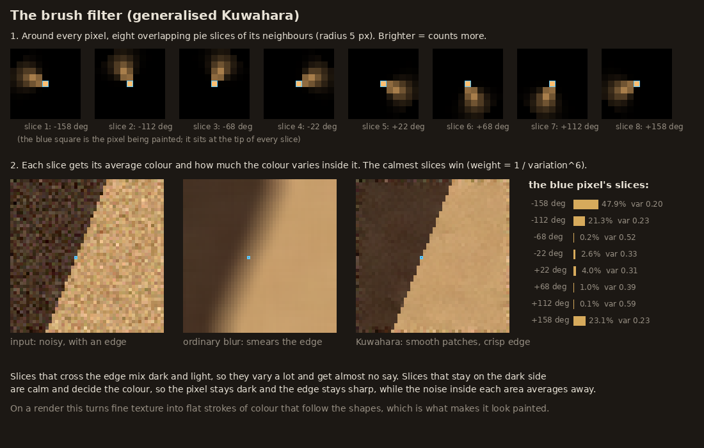

An ordinary blur averages each pixel with all its neighbours, which smears edges. The
**Kuwahara filter** is a blur that keeps edges. For every pixel:

1. Split its neighbourhood (radius 5 px) into 8 overlapping pie slices, one per direction.
   Each slice fades out towards its sides and its rim (`sector_kernels()`).
2. For each slice, work out the **average colour** and the **variation**: the standard
   deviation, using `variation² = average(colour²) − average(colour)²`.
3. Blend the 8 averages, giving each slice the weight `1 / variation⁶`. The calmest slice
   dominates.

The picture is made of flat patches, so on a smooth area every slice is calm, the averages
agree, and the noise and fine texture melt into a flat patch.

At an edge, the slices that cross it hold both dark and light, so they vary a lot. Raised
to the sixth power, that variation gives them almost no weight. A slice lying wholly on
one side of the edge is calm and wins, so the pixel keeps its own side's colour and the
edge stays crisp. The bar chart in the diagram shows this for one pixel next to an edge:
the three slices pointing back into its own (dark) side carry over 90% of the weight, and
the slices reaching across the edge get almost none.

This version is the "generalised" Kuwahara of Papari, Petkov and Campisi (2007). The
original used four hard-edged squares, which leaves blocky artefacts. Two practical
details:
- Every average is weighted by the picture's alpha, so the transparent background doesn't
  leak into the item's edges.
- The averages over each slice are convolutions, done with the fast Fourier transform
  (`_Convolver`), so a 512 px picture takes under a second.

Before and after, close up (a patch of the shield, enlarged):

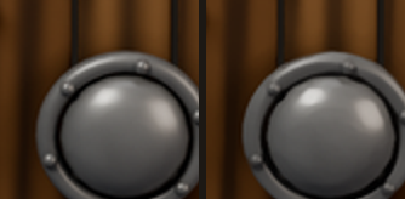

The radius sets the size of the strokes. The comparison below shows each radius at full
size and at the 64 px the game uses (1× and 2×):

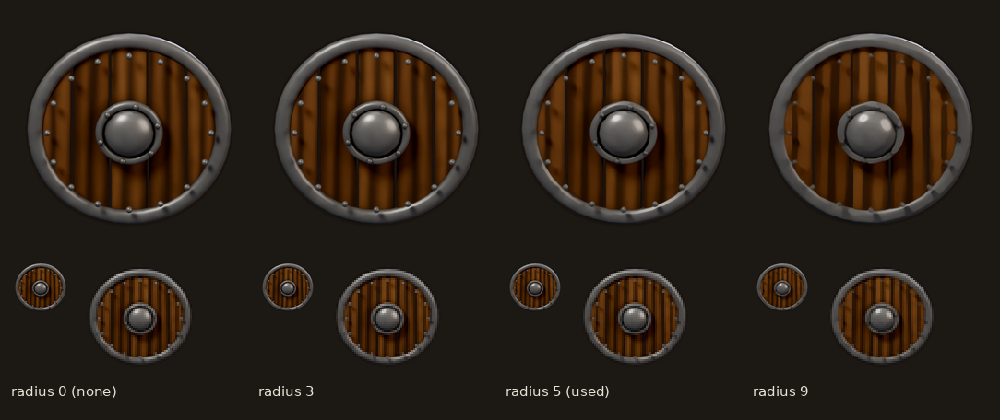

Be honest with yourself about what this shows. At 64 px the radii differ only slightly:
at icon size the brushwork's job is to calm the render's fine noise and texture into flat
areas of colour before shrinking, not to leave visible strokes. Close up, radius 3 is
hard to tell from none, and at 9 the wood grain starts to smear into broad streaks.
Radius 5, chosen during the style test, sits between the two.

### Step 9: colour and outline

Three small adjustments (`finish_painted()`):

```
grey       = 0.299·R + 0.587·G + 0.114·B          how bright each pixel looks
colour     = grey + (colour − grey) × 1.12         12% more saturated
colour     = (colour − 0.5) × 1.06 + 0.5           6% more contrast
```

Then the outline:
1. Take the item's silhouette (its alpha) and grow it by 4 px in every direction, with a
   maximum filter: each pixel takes the largest alpha within 4 px.
2. Soften it slightly with a 1.4 px blur.
3. Fill it with a very dark brown (`#1a120c`) at 92% opacity.
4. Lay the item on top.

What sticks out around the item is the ink line.

### Step 10: down to 64 pixels

The 512 px picture is shrunk to 64×64 with the Lanczos filter, the sharpest standard
resampling. A light unsharp mask (radius 1, 60%) brings back crispness lost in shrinking.
The classic icons' soft drop shadow is then added below and to the right: the alpha at 55%,
blurred 1.6 px, offset 2 px. That is `render_icon()` in `render_items_painted.py`.

---

## 5. The materials, one by one

Every material in `painted.py` is `_painted()` from section 4 with its own settings, plus a
pattern of its own:

| Material | Used for | Its own pattern | Notable settings |
|---|---|---|---|
| `metal()` | blades, steel | fine directional scratches: noise stretched 30× along one axis, used as a bump | `metallic 0.8`, `rough 0.42`, pale edge `#f2ede0`, strong wear |
| `gold()`, `iron()` | brass and gold fittings, dark iron | (as metal) | gold has no scratches, a yellow edge colour |
| `wood(colour, grain, along)` | hafts, planks, bows | **grain**: Blender's Wave texture in *bands*, distorted (6) so the lines wander, on coordinates squeezed along the grain direction so the bands run lengthwise; also a bump | grime 0.9 so the grain darkens in its grooves |
| `leather()` | grips, straps, armour | blotchy mottling (noise, scale 22) and fine pores (noise, scale 60) as a bump | strong edge wear (scuffing) |
| `cloth(colour, weave)` | cloaks, wrappings, fletching | **weave**: two Wave textures at right angles multiplied, so threads cross; used as a bump | rough 0.9, little wear |
| `chain(colour, rings)` | mail | **rings**, see below | metallic 0.65, bump 0.8 |
| `pages()` | book pages, paper tags | thin Wave bands along the height: the edges of the leaves | |
| `fruit()` | the apple | a second colour in streaks running stalk to base: noise squeezed vertically | a waxy coat |
| `skin()` | (characters) | a little subsurface scattering, so light glows through | |
| `glass()` | flasks, lantern panes | fully transmissive, IOR 1.35, a clear coat | not painted: glass doesn't wear |
| `glow(colour, strength, core)` | potions, gems, flames | lit from inside: a spherical gradient makes the centre brighter (`core` colour) | `gloss=False` for flames (no shine) |

### The mail rings, worked out

Real mail is rows of rings, each row shifted half a ring. `_ring_pattern()` builds this
from five lines of arithmetic, on the surface's own coordinates (`x` across, `z` up) times
the ring count (and `z` by a further 1.15, so the rows sit a little closer than the rings
in a row, as real rings overlap):

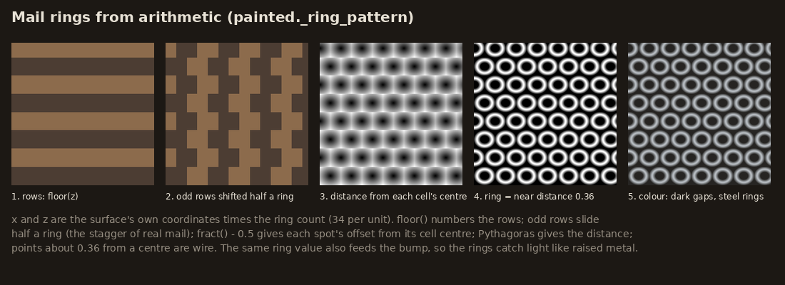

```
row   = floor(z)                          which row (0, 1, 2...)
shift = (row mod 2) × 0.5                 odd rows slide half a ring
fx    = fract(x + shift) − 0.5            offset from the cell centre, −0.5..0.5
fz    = fract(z) − 0.5
d     = √(fx² + fz²)                      distance from the centre (Pythagoras)
ring  = MapRange(|d − 0.36|, 0.16 → 0, 0.02 → 1)   1 on a circle of radius 0.36
```

`floor` rounds down and `fract` keeps what's after the decimal point, so together they cut
the surface into cells. The colour mixes from near-black gaps to steel by `ring`. The same
value drives the bump, so the rings shade like raised wire.

---

## 6. The models

A painted look on a plain model still looks plain, so every item was re-modelled in
`render_items_painted.py`. Some of the techniques:

- **Blades** (`blade_mesh`): each cross-section is 10 points with a sharp edge, a raised
  shoulder and a groove (fuller) down the middle. They narrow towards the tip and the
  fuller runs out. Light catches each facet differently.
- **Wrapped grips** (`wrapped_grip`): a cord spirals round a core, a helix. At fraction `t`
  of the way along it is at `(x0 + (x1 − x0)·t, r·cos(2π·turns·t), r·sin(2π·turns·t))`.
- **Tubes along paths** (`tube`): quillons, knuckle bows, laces, straps and the bow's limbs
  are tubes swept along a list of points, with a radius at each point. That is how the bow
  tapers towards its tips, which curl the other way (recurve).
- **Cut sheet shapes** (`plate`): a flat 2D outline thickened. Used for arrowheads, mace
  flanges, holy-symbol rays, the helm's nasal guard and leaves.
- **Forged blades** (`wedge`): the axe bits are a flat cheek in the middle and a ground
  bevel tapering to a thin edge. The sloping bevel catches light differently from the
  cheek (section 7 explains why this was needed).
- **Lathe shapes** (`lathe`): bottles, the helm's dome and armour bodies are a profile
  (radius at each height) spun around the vertical axis. With 8 sides and flat shading
  instead of 40 smooth ones, the greater-healing flask becomes cut crystal.
- **Chains** (`oriented_torus`): each link is a ring stretched 1.4× along the chain,
  alternately lying flat and standing on edge, like real links.
- **Placement on curved bodies** (`front`, `radius_at`): studs, laces and buckles have to sit
  on the armour's surface. The body is a lathe squashed to 55% depth, an ellipse in
  cross-section. So at height `z` and sideways offset `x`, the front surface is at
  `y = −0.55 × √(r(z)² − x²)`.

The camera, framing and 64 px output are the same as for the classic icons. Weapons and
tools lie diagonally and are seen from high above (60–75°); armour, potions and jewellery
stand facing the viewer, seen from low down (12–30°); the pile of rations and the coins are
in between (45°).

---

## 7. How the settings were chosen

None of the numbers came from theory alone. Each was set by rendering, looking, and
changing what looked wrong. The method:

- **Look at it next to the reference**, and **at the size the player sees** (64 px), not
  only at the 512 px close-up. Some things that looked fine large were mud small.
- **When something looks wrong, render the stages separately** (`painted.PREVIEW`) to find
  which step causes it before changing anything.
- **Change one thing at a time** where possible, so you know what fixed it.

What went wrong along the way, and what fixed it:

**During the style test (four icons):**
- **Everything too bright.** The first renders had blown-out white steel, plastic-looking
  gold, and so little variation that the brush filter had nothing to work with. Fixes:
  - switched to the AgX view transform (section 4, step 7);
  - cut the key light from 1100 W to 520 W;
  - darker base colours for metal;
  - the smudge noise layer;
  - weaker glow on gems.
- **Mail looked like cobblestones.** The first mail used a Voronoi texture, Blender's
  "crackle" cell pattern, the same one the classic icons use. At 512 px it read as paving,
  not rings. It was replaced by the ring arithmetic in section 5.
- **The potion looked like red plastic.** The liquid filled the whole flask with one flat
  colour. Fixes: filled only to the shoulder; a darker colour with a brighter heart (the
  `core` of `glow()`); two bubbles.
- **Mail too dark, rings too fine.** Next to the reference's chain shirt ours looked like a
  dark knitted tunic. Fixes:
  - rings 60 → 34 per unit, so each ring is big enough to read;
  - ring colour `#8e939a` → `#b4b9c0`;
  - gaps less black (`#151413` → `#262523`);
  - metallic 0.8 → 0.65, so less of the dark surroundings is reflected;
  - a leather placket down the front, as in the reference.
- **The shield looked like a barrel lid.** A dark iron rim plus two iron straps across the
  planks read as a barrel. The reference has a pale, scuffed steel rim and no straps.
  Fixes: worn steel for the rim and boss (metallic 0.55), straps removed, browner and less
  orange planks.

**Rolling out to all 34 icons:**
- **The mace head looked like a hollow cage.** Seen from above, seven thin flanges with
  dark gaps between them read as a cage or a whisk. Fix: a solid, egg-shaped head with
  eight shorter, thicker flanges, and lighter steel so the head reads as one lump.
- **The axe bits were flat, pale slabs.** This one took several rounds and shows the method:
  1. Thick-to-thin wedges instead of flat plates: no visible change.
  2. Rolling the axe 30° about its haft: no visible change.
  3. The stage renders found the cause. The edge mask was fine, and even the flat-colour
     stage was uniformly pale. One flat face lit evenly has nothing to shade, so
     materials couldn't fix it.
  4. Geometry, then: a flat cheek plus a ground bevel. The facets appeared, faintly.
  5. A darker base colour: almost no change. So the brightness was not the paint colour;
     the likely culprit was the half-matte surface (metallic 0.5), spreading the overhead
     lights evenly over the whole face.
  6. A more mirror-like steel (metallic 0.88, roughness 0.34) confirmed it: it reflects
     the dark studio except where the lights are, and the facets and edge now show.
- **The helm was too dark at 64 px.** Fine large, a black blob small. Fix: lighter steel,
  metallic 0.62.
- **Gold coins looked dull bronze**, and a stack set far to the side made the pile tiny in
  the frame. Fix: a brighter gold and the stack moved in.
- **The garnet was small**, because two loose chips beside it made the framing zoom out.
  Fix: one stone.
- **The Fever Draught looked like a jam jar.** A squat jar of salve was the wrong object for
  a *draught*. Fix: a gourd-shaped flask, corked and sealed, with a paper tag.
- **The torch flame:**
  1. It first read as a white feather: too bright, so AgX faded it towards white, as the
     tone strip shows.
  2. Then as a glossy peach balloon: the gem material's shiny coat.
  3. Fix: a teardrop shape with no shine, glowing only gently, in strong orange with a
     yellow heart.

---

## 8. Tuning knobs

Where to change things, and what to expect:

| Knob | Where | Default | Effect |
|---|---|---|---|
| `var` | `_painted(..., var=)` | 0.12 (metal 0.2) | Unevenness of the colour. 0 = flat, 0.3 = blotchy. |
| `grad` | `_painted(..., grad=)` | (0.78, 1.12) | Dark-to-light from bottom to top. (1, 1) turns it off. |
| `grime` | `_painted(..., grime=)` | 0.85 | How dark the crevices go. 0 = clean. |
| `ao_dist` | `_painted(..., ao_dist=)` | 0.04 (4 cm) | How far away something can be and still count as "blocking". Larger = broader, softer grime. |
| `edge_strength` | `_painted(...)` | 1.0 metal, 0.7 wood | How pale worn edges get. |
| `bevel` | `_painted(..., bevel=)` | 0.006 (6 mm) | Width of the worn band along edges. |
| `chip` | `_painted(..., chip=)` | 0.55 metal, 0.3 wood | How broken up the wear is. 0 = a clean line. |
| Edge thresholds | `edge_mask(lo=, hi=)` | 0.02, 0.22 | Lower `hi` and gentler curves count as edges too. |
| Light strengths | `studio(key=, rim=, fill=)` | 520, 520, 150 | Overall brightness and how strong the cool rim is. |
| View look | end of `studio()` | `AgX - Punchy` | `AgX - Base Contrast` is softer, `AgX - Medium High Contrast` in between. |
| Brush radius | `finish_painted(radius=)` in `render_icon()` | 5 | Stroke size (see the comparison in step 8). 0 turns brushwork off. |
| `q` | `kuwahara(q=)` | 6 | How strictly the calmest slice wins. Lower blends more (softer edges). |
| Saturation, contrast | `finish_painted(...)` | 1.12, 1.06 | 1.0 leaves the picture as rendered. |
| Outline | `finish_painted(outline_px=, outline=)` | 4 px, `#1a120c` | 0 for no outline. The width is at 512 px, so 4 px is half a pixel at 64. |
| Sharpening | `render_icon()` | UnsharpMask(1.0, 60, 2) | Crispness after shrinking. |

Tip: try a change on one icon with `render_all.py --style painted items:shield`, then look at
it in the game with the Esc menu toggle, or in the comparison sheet (section 12).

---

## 9. Adding or changing an icon

1. Add the item to `data/items/items.json` with its classic icon path, as usual
   ([ITEMS.md](ITEMS.md)).
2. **Classic icon:** a function in `render_items.py`, added to its `ALL` table.
3. **Painted icon:** a function in `render_items_painted.py` that builds the model under
   `root`, decorated with the item's name and camera elevation:

   ```python
   @item("silver_dagger", 72)
   def silver_dagger(root):
       blade_mesh("Blade", 0.32, 0.075, 0.018, painted.metal("Blade", "#c4c8ce"), root)
       ...
       ri.diagonal(root, 40)
   ```

   Build it from the helpers in section 6 and the materials in section 5. Give metal parts
   a bevel (`bevel(obj)`) or real corners so the edge mask has something to find.
4. Render both: `render_all.py items:silver_dagger`. Then let Godot import the PNGs.
5. Check it next to the others with `compare_icon_styles.py` (section 12) and in the game.
6. Run the tests. `test_every_item_has_icons_in_both_styles` fails if the painted icon is
   missing.

You can skip step 3 at first: an item without a painted icon shows its classic one in both
styles, so the game works; the test in step 6 is there to remind you it's missing.

---

## 10. Why only the icons (for now)

The same materials and finishing were tried on Garrick's fighter sprite
(`tools/art/blender/style_test.py`):

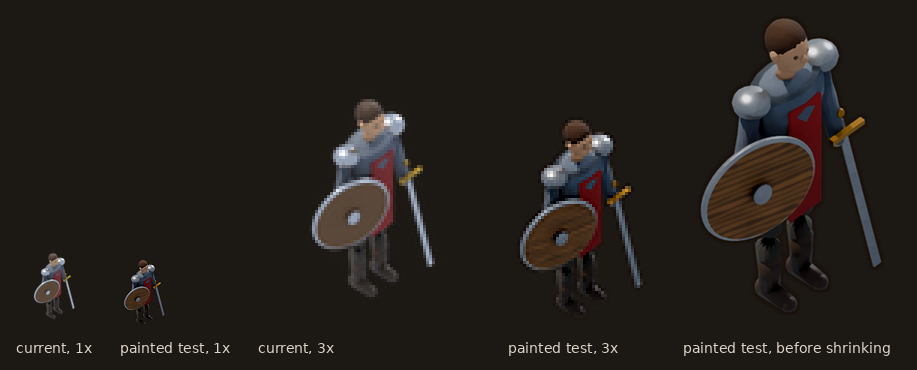

The difference at game size is small: warmer colour, a slightly firmer outline, wood grain
on the shield. The reason is the pixel budget.
He is about 50×75 pixels on screen, rendered 8× larger and shrunk, so:
- a brush stroke of radius 6 at that size becomes less than one pixel in the game;
- edge wear only 6 mm wide on a man-sized figure is smaller still.

The painter's tricks need room to show. A 64 px icon of one sword has that room; a
whole person in about 50×75 does not.

There is also consistency to think about. Characters stand among the trees, houses and
props, which are all in the classic style, and each character has 45 animation frames.
Converting characters alone would make them clash with the world. Characters would make
sense together with larger sprites, a closer camera, or the whole world converted. The
style switch is ready for that: their files would go in `assets/characters/painted/`.

---

## 11. Limits

- **It is not hand-painted.** A painter exaggerates, invents highlights and simplifies on
  purpose; this only imitates the results of some of those habits. The reference art's
  loose, visible brush marks and sculpted ornament are beyond it.
- **Detail is limited by the models.** Every rivet and buckle is modelled in code. Very
  ornate items (filigree, engraving, sculpted leather) would take a lot of modelling.
- **Rendering is slower.** The Bevel and Ambient Occlusion nodes sample the scene many
  times per pixel. A painted icon takes about 6 to 25 seconds on 4 CPU cores, about 8
  minutes for all 34.
- **Noise is random, but seeded.** Re-rendering gives the same picture, but a small change
  to a model can move the chips and smudges around.

---

## 12. Files, and how to remake every picture here

| File | What it is |
|---|---|
| `tools/art/blender/painted.py` | The painted materials, the light rig and the `PREVIEW` switch |
| `tools/art/blender/paint_filter.py` | The finishing pass: Kuwahara brushwork, colour, outline (numpy and Pillow only) |
| `tools/art/blender/render_items_painted.py` | The 34 painted models and `render_icon()` |
| `tools/art/blender/render_items.py` | The classic icons (unchanged) |
| `tools/art/blender/render_all.py` | Renders everything; `--style` picks a style |
| `tools/art/blender/painted_breakdown.py` | The step-by-step shield pictures, the brush close-ups and the AgX strip in this document |
| `tools/art/blender/style_test.py` | The Garrick experiment from section 10 |
| `tools/art/docs/style_diagrams.py` | The diagrams in this document (numpy and Pillow only) |
| `tools/art/docs/compare_icon_styles.py` | The classic-and-painted sheet at the top of this document |
| `scripts/autoload/game_config.gd` | `art_style`, `ART_STYLES`, `styled_path()` |
| `scripts/autoload/data_registry.gd` | `set_art_style()` |
| `scripts/ui/game_menu.gd` | The **Item icons** button |
| `tests/unit/test_art_style.gd` | The tests |

```sh
.venv-art/bin/python tools/art/blender/painted_breakdown.py      # shield stages, close-ups, tone strip
python3 tools/art/docs/style_diagrams.py                          # diagrams
python3 tools/art/docs/compare_icon_styles.py                     # icon comparison sheet
```
