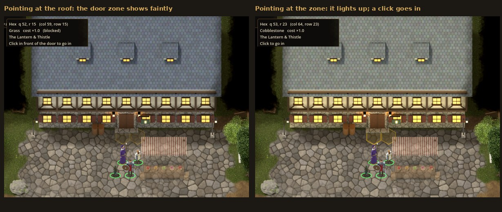

# The four-phase plan: what's done, what isn't, what was added

Before any code was written we agreed a plan of four phases, and your answers to ten
questions added some ground rules. This page checks every item of that plan against the
game as it stands. It also lists what is still to do, and what was added that the plan
didn't include.

**Status words:** **Done** works end to end and is tested. **Partly** works, with the gap
named. **Not yet** hasn't been started. **Out of scope** was agreed to be left out.

## At a glance

| Phase | What it covered | Status |
|---|---|---|
| 1. Foundation | Hex grid, pathfinding, camera, party selection, portrait sidebar, click to move, an outdoor map, minimap | **Done** |
| 2. Items and places | Items and equipment, inventory screen, chests and drawers, gold, building interiors; also fog of war, save/load and audio from your answers | **Done** (spell scrolls moved to Phase 4) |
| 3. People | NPCs, dialogue, quests, vendors, temple revival | **Done** |
| 4. Combat | Initiative, turn-based actions on hexes, weapon and armour stats, spells and abilities, enemies and AI, death and game over; also XP and levelling | **First half done.** Spells, spell slots, scrolls, resting and class features are still to do |

---

## The ground rules (your answers before Phase 1)

| Requirement | Status | Where / notes |
|---|---|---|
| Latest stable Godot, GDScript | **Done** | Godot 4.7, GDScript only |
| 2D | **Done** | Pre-rendered 3D art shown as 2D sprites, as Baldur's Gate did |
| CC0 assets where needed, otherwise self-made | **Done** | All art is rendered by scripts in the repo; portraits are CC0 paintings from the Met; sounds are synthesised ([ASSETS.md](ASSETS.md), [CREDITS.md](../CREDITS.md)) |
| Hex grid everywhere | **Done** | Outdoors, indoors and in fights |
| Real-time exploring, turn-based once hostile | **Done** | A fight starts when creatures notice the party, or when you click one |
| Loose 5e rules, no strict IP | **Done** | SRD 5.1 numbers only, credited in CREDITS.md |
| Party of 4, easy for a developer to change | **Done** | `max_party_size` in `game_config.json`, `data/party/starting_party.json` |
| Character sheets as importable JSON, writable from Python | **Done** | `data/characters/*.json`, `tools/make_character.py` ([CHARACTER_SHEETS.md](CHARACTER_SHEETS.md)) |
| Separate maps for building interiors | **Done** | Six interiors, each the size of its building |
| Save/load with a rudimentary slot menu | **Done** | Named slots with thumbnails, quicksave and quickload |
| Dialogue with no addons | **Done** | In-house JSON dialogue; the project has no addons at all |
| Drop-in replaceable placeholders | **Done** | Every PNG and sound can be swapped at the same path |
| Levelling and XP | **Partly** | XP from quests and fights. A level-up adds hit points, and the proficiency bonus and Sneak Attack dice grow with level. New class features or spells per level are not done (they need the Phase 4 second half). |
| Fog of war | **Done** | With line of sight, on the minimap too, configurable |
| Minimal audio | **Done** | Music, ambience and sound effects by name ([AUDIO.md](AUDIO.md)) |
| Character creation | **Out of scope** | As agreed |
| Cutscenes | **Out of scope** | As agreed |

---

## Phase 1: Foundation (Done)

| Planned | Status | Where |
|---|---|---|
| Hex grid | **Done** | `scripts/core/hex.gd`, `hex_grid.gd` |
| Pathfinding | **Done** | A* weighted by terrain cost (`HexGrid.find_path`) |
| Camera | **Done** | Pan (keys, screen edge, middle drag), zoom towards the cursor (`game_camera.gd`) |
| Party selection and portrait sidebar | **Done** | Click, Shift-click, box select, number keys, portraits (`party_controller.gd`, `hud.gd`) |
| Click to move | **Done** | The group fans out around the clicked hex |
| One outdoor map with trees, a river, houses and signs | **Done** | Millbrook Outskirts (84×56 hexes) |
| Minimap | **Done** | With party dots and the camera rectangle, click to pan |

## Phase 2: Items and places (Done)

| Planned | Status | Where |
|---|---|---|
| Item and equipment data | **Done** | 34 items with 5e SRD numbers ([ITEMS.md](ITEMS.md)) |
| Inventory and equipment screen | **Done** | Paper doll with ten slots, 16-slot backpack, drag and drop |
| Chests and drawers | **Done** | Plus cupboards and a crate; locks, keys and lock-picking |
| Gold | **Done** | A shared party purse |
| Entering building interiors | **Done** | Since this update, only from the hexes in front of the door (see below) |
| Fog of war (from your answers) | **Done** | `fog_of_war.gd` |
| Save/load with slots (from your answers) | **Done** | `save_manager.gd`, `save_load_screen.gd` |
| Audio hooks (from your answers) | **Done** | `audio.gd`, `data/audio/audio.json` |

**What you added during Phase 2:**
- A bar and tables as furnishing add-ons for any house: **Done**.
- Dropping and picking up items: **Done**.
- Spell scrolls: moved to Phase 4 at your request; **Not yet**.

**"We will revisit the rest of Phase 2 later":** you didn't name specific items, so nothing
is recorded as missing from Phase 2. If you want somewhere to start, these are the known
limits of the item system today:
- Using an item does only one thing: heal (potions, food). A `"tool": "lockpick"` lets
  the holder pick locks.
- Of the passive bonuses on worn items, only armour class (`"bonuses": {"ac": 1}`) is
  implemented.
- There is no way to split a stack by an amount you choose.
- There are no unidentified magic items and no trapped containers.

## Phase 3: People (Done)

| Planned | Status | Where |
|---|---|---|
| NPCs (townsfolk) | **Done** | 7 townsfolk with their own sprites and portraits ([NPCS_AND_QUESTS.md](NPCS_AND_QUESTS.md)) |
| Dialogue | **Done** | Branching JSON conversations with conditions and effects ([DIALOGUE.md](DIALOGUE.md)) |
| Quests | **Done** | 7 quests (4 in Millbrook, 3 from Phase 4) and a journal (J) |
| Vendors (buy and sell) | **Done** | The innkeeper, the blacksmith and the herbalist |
| Temple revival; game over only when the whole party is down | **Done** | Father Anselm heals and raises; a game-over screen offers a load |

## Phase 4: Combat (first half done)

| Planned | Status | Where / what's missing |
|---|---|---|
| Initiative | **Done** | d20 + Dex, an initiative strip along the top |
| Turn-based actions on hexes | **Done** | Movement, Attack, Dash, Dodge, Disengage, potions, off-hand attacks, opportunity attacks ([COMBAT.md](COMBAT.md)) |
| Weapon and armour stats | **Done** | To-hit and damage from the sheet, finesse, versatile, ranged and ammunition, damage types, armour class |
| Spells and abilities | **Partly** | Sneak Attack (Wren) and the Defense fighting style (Garrick) work. **Not yet:** spells and cantrips, spell slots, spell scrolls, Second Wind and other class features, and a spell/ability bar in the sidebar (from your first message) |
| Enemies and AI | **Done** | Wolves, bandits, bandit archers, skeletons, skeleton archers; melee and ranged AI |
| Death and game over | **Done** | Death saving throws, massive damage, the dead raised at the temple, game over |
| XP and levelling (from your answers) | **Partly** | XP from fights, shared by the party; level-ups as in the ground rules above |

**Also not yet** (listed at the end of [COMBAT.md](COMBAT.md)):
- short and long rests;
- thrown weapons;
- fleeing a fight;
- saving in the middle of a fight.

---

## Added beyond the plan

### At your request, along the way

| Added | When | Notes |
|---|---|---|
| Seamless terrain, with the hex grid shown only for movement | Phase 1 follow-up | A blended terrain shader instead of hex tiles |
| Buildings as big outside as inside | Phase 1 follow-up | A cottage is 8×6 hexes both outside and in |
| Realistic, less cartoony art | Phase 1 follow-up | A Blender pipeline renders terrain, buildings, props and characters ([ASSETS.md](ASSETS.md)) |
| More art polish | Phase 1 follow-up | Several looks per prop, set dressing, animated water, characters walking in 8 directions, a colour grade |
| Better 2D portraits | Before Phase 2 | CC0 Old Master paintings from the Met |
| A guide to how the game is built | Before Phase 2 | [GODOT_GUIDE.md](GODOT_GUIDE.md) |
| Bar and table add-ons; dropping and picking up items | Phase 2 | See Phase 2 above |
| A study checklist | After Phase 4a | [START_HERE.md](START_HERE.md) |
| Painted item icons, a switch between the two styles, and the reference art | After Phase 4a | [PAINTED_STYLE.md](PAINTED_STYLE.md); `"art_style"` in `game_config.json`; the Esc menu button |
| Entering buildings only from the hexes in front of the door | This update | [Below](#door-zones-this-update) |

### Added while building, without being asked

These are things I added because the planned features needed them or felt incomplete
without them. Each is small and documented, and you can remove or keep any of them:

- **Movement feel:** smooth walking that still ends on hex centres; group formations;
  buildings and trees turning see-through when someone walks behind them; real-time pause.
- **Information:** a hover panel (F3) with terrain, move cost and path length; a controls
  panel (F1); toasts; hit chances shown when hovering an enemy.
- **Items:** locks, keys and lock-picking with thieves' tools; giving an item by dropping
  it on a portrait; items lying on the map (the reeve's key); carry weight and speed.
- **Fog:** a building shows whole once any part of it is seen.
- **People:** party members with their own dialogue lines; quest stages that advance by
  themselves; quest XP; what you sell stays on the vendor's shelf.
- **Combat presentation:** a combat log, floating damage numbers, health bars over
  enemies, a shaded movement area and sounds.
- **A second map**, the Old Temple Road, with a bandit camp and a ruined temple, and three
  quests built around fights.
- **Developer aids:**
  - Debug keys: Ctrl+K knocks out the leader, Ctrl+Shift+K kills them.
  - Python generators that write the maps.
  - A headless test suite: 119 tests, which fail on any engine error.
  - Screenshot scripts.
  - A document for each system: MAPS, ITEMS, CHARACTER_SHEETS, DIALOGUE, NPCS_AND_QUESTS,
    COMBAT, ASSETS, AUDIO.

### Changed from the original proposal

- **Party size:** the proposal said up to 6; you chose 4, with the limit in the config.
- **Art:** the proposal expected coloured shapes or a CC0 pack such as Kenney. The CC0 art
  sites were blocked from this environment, so the art is rendered with Blender instead.
- **XP and levelling, fog of war, audio and save slots** were out of scope in the proposal.
  You brought them in, and they went into Phases 2 to 4.
- **Spell scrolls** moved from Phase 2 to Phase 4.
- **Maps** are JSON with text rows, written by Python generators. The proposal had a script
  turning text layouts into Godot tile maps; the result is the same idea without
  `TileMap`, because the terrain is drawn by its own shader.

---

## Door zones (this update)

A building used to be entered by clicking anywhere on its picture. That picture is a large
rectangle, so a click on the ground behind a house also sent the party inside. Now:

- Each building has a **door zone**: the open ground hexes touching its door, outside its
  footprint. Every building on the maps today has two.
- **Clicking a door zone hex** sends the party to the door and inside.
- **Clicking anywhere else** (the walls, the roof, the ground behind or beside the building)
  is an ordinary move. The party can walk right round a building, and can even stand on
  the door zone via an ordinary move order, without going in.
- **Pointing at a building** shows its door zone faintly. **Pointing at the zone** lights
  it up, highlights the building and shows a hand cursor with "Click to go in".

The code: `_build_door_zones`, `door_at` and `_clickable` in `scripts/world/world.gd`, and
`door_zone` in `scripts/world/cursor_overlay.gd`. The test is
`test_buildings_are_entered_only_from_the_door_zone` in
`tests/integration/test_phase2.gd`. Ways out of buildings (the mat inside the door) and
the road's waymarker are clicked as before.

---

## Suggested order for what's left

1. **Phase 4, second half:**
   - spells and cantrips, with spell slots;
   - spell scrolls;
   - short and long rests (Tobin's room becomes a long rest);
   - Second Wind and other class features;
   - a spell and ability bar.

   [GODOT_GUIDE.md](GODOT_GUIDE.md), "Where the next phases plug in", sketches how.
2. **The rest of combat:** thrown weapons, fleeing, saving mid-fight.
3. **Levelling beyond hit points:** features and spells gained by level.
4. **Whatever you had in mind for "the rest of Phase 2".**
5. **Optional:** the painted style for characters and the world, which would need larger
   sprites or a closer camera ([PAINTED_STYLE.md](PAINTED_STYLE.md), section 10).
