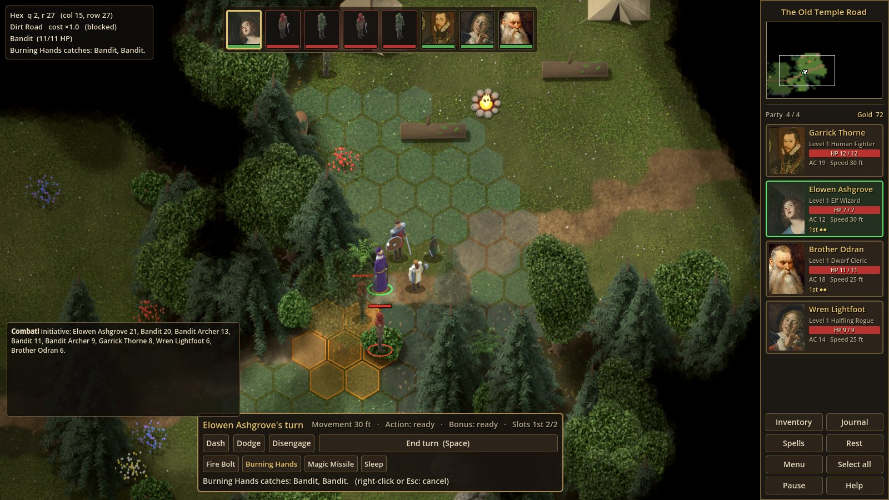
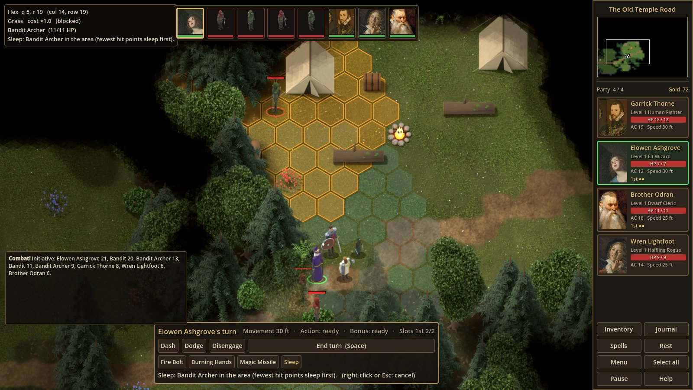
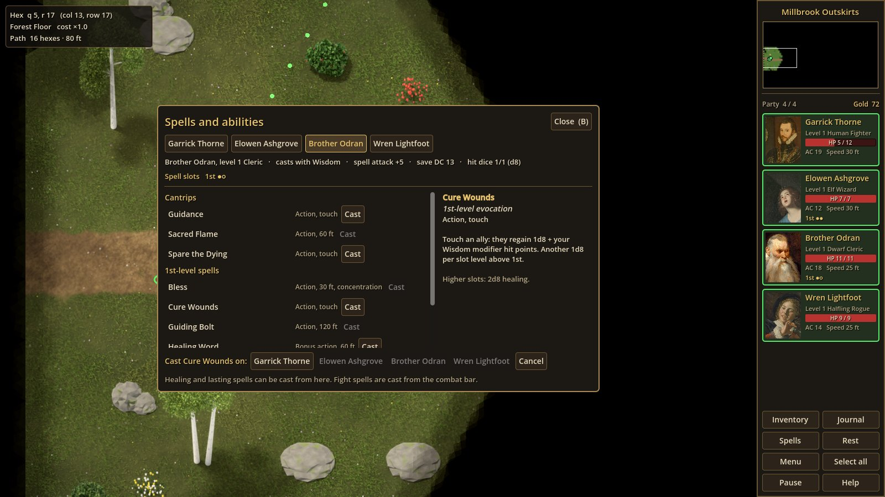
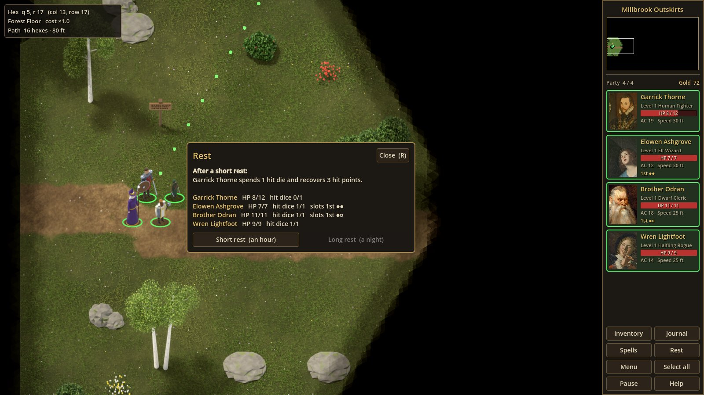
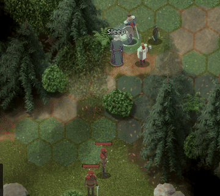
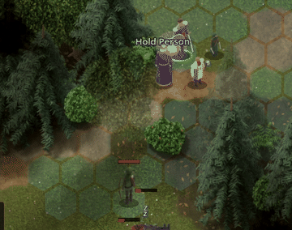
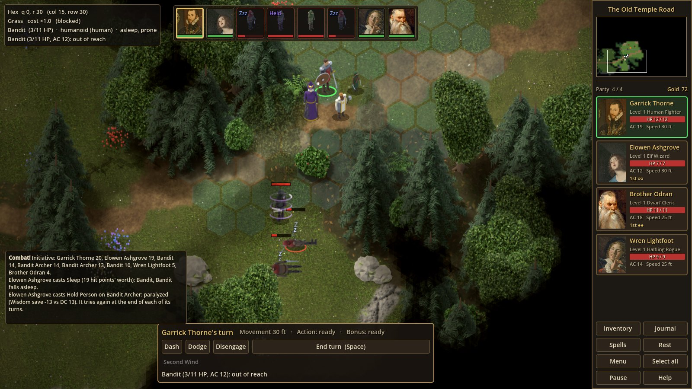

# Spells, class features and resting

Phase 4, second half: spellcasting, the class features that go with levelling up, spell
scrolls and rests. The rules follow the 5e SRD, simplified where noted.






| File | Class | What it does |
|---|---|---|
| `data/spells/spells.json` | | Every spell, as data. |
| `data/classes/classes.json` | | What each class gains at each level (features, spells), and the features themselves. |
| `scripts/rules/spell_def.gd` | **SpellDef** | One spell from the file (feet turned into hexes). |
| `scripts/rules/spellcasting.gd` | **Spellcasting** | A character's casting: spells known, slots, attack bonus and save DC, dice that grow, and the effects that only touch character sheets (healing, buffs). |
| `scripts/rules/classes.gd` | **Classes** | The class table: `Classes.grant(sheet)` adds whatever the sheet's level entitles it to. |
| `scripts/rules/features.gd` | **Features** | Uses of limited features and when they come back. |
| `scripts/rules/rest.gd` | **Rest** | Short and long rests, and where you may take them. |
| `scripts/rules/abilities.gd` | **Abilities** | Spells, scrolls and features used **outside** a fight (the spells screen, reading a scroll from the inventory). |
| `scripts/combat/combat_spells.gd` | **CombatSpells** | Casting **in** a fight: what can be cast now, areas on the hex grid, the cursor preview, and the effects. |
| `scripts/combat/combat_features.gd` | **CombatFeatures** | Second Wind, Action Surge, Cunning Action, Turn Undead, Preserve Life in a fight. |
| `scripts/ui/spells_screen.gd` | **SpellsScreen** | The spells and abilities screen (B). |
| `scripts/ui/rest_dialog.gd` | **RestDialog** | The rest dialog (R). |

## The spells in the game

| Spell | Level | Class | What it does here |
|---|---|---|---|
| Fire Bolt | cantrip | wizard | Ranged spell attack, 1d10 fire, 120 ft. |
| Light, Mage Hand | cantrip | wizard | Listed on the sheet, no effect yet. |
| Sacred Flame | cantrip | cleric | Dexterity save or 1d8 radiant, 60 ft. |
| Guidance | cantrip | cleric | Touch: +1d4 to the target's next ability check (picking a lock, say). |
| Spare the Dying | cantrip | cleric | Touch: a dying companion becomes stable. |
| Magic Missile | 1st | wizard | Three darts of 1d4+1 force that never miss (one more per slot level above 1st). |
| Burning Hands | 1st | wizard | 15-ft cone, Dexterity save, 3d6 fire, half on a save (+1d6 per slot level). |
| Sleep | 1st | wizard | 20-ft circle up to 90 ft away: 5d8 hit points' worth of creatures fall asleep (and prone), fewest hit points first (+2d8 per slot level). Not undead, nor anything that can't be charmed, nor elves. Allies in the circle count too. See [Sleep and Hold Person](#sleep-and-hold-person). |
| Shield | 1st | wizard | Reaction, cast for you: +5 armour class until your next turn, when that turns a hit into a miss. |
| Mage Armor | 1st | wizard | Touch, no armour worn: armour class 13 + Dex until a long rest. |
| Bless | 1st | cleric | Up to three allies within 30 ft add 1d4 to attack rolls and saving throws; concentration, 10 rounds. |
| Cure Wounds | 1st | cleric | Touch: 1d8 + Wisdom hit points (+1d8 per slot level). |
| Healing Word | 1st | cleric | Bonus action, 60 ft: 1d4 + Wisdom hit points (+1d4 per slot level). |
| Guiding Bolt | 1st | cleric | Ranged spell attack, 4d6 radiant; the next attack against the target has advantage. |
| Scorching Ray | 2nd | wizard | Three rays, a spell attack each, 2d6 fire (one more ray per slot level). |
| Misty Step | 2nd | wizard | Bonus action: teleport to a spot you can see within 30 ft. |
| Aid | 2nd | cleric | Up to three allies gain 5 hit points (current and maximum) until a long rest (+5 per slot level). |
| Hold Person | 2nd | wizard, cleric | A humanoid within 60 ft: Wisdom save or paralyzed (concentration, up to 10 rounds), saving again at the end of each of its turns. One more humanoid per slot level. See [Sleep and Hold Person](#sleep-and-hold-person). |

Elowen (wizard) and Odran (cleric) start with the level 1 spells; Mage Armor comes at
level 2, and the 2nd-level spells (Scorching Ray, Misty Step, Aid, Hold Person) at level
3, when full casters get their first 2nd-level slots. Elowen also starts with a **scroll
of Hold Person**, so it can be tried at level 1.

## The numbers

**Spell attack bonus** = proficiency bonus + casting ability modifier (Intelligence for a
wizard, Wisdom for a cleric). Elowen at level 1: +2 + 3 = **+5**.

**Save DC** = 8 + the spell attack bonus. Elowen: **13**. A creature caught by Burning Hands
rolls d20 + its Dexterity save bonus; 13 or more halves the damage.

**Spell slots** (full casters, SRD table; `Spellcasting.FULL_CASTER_SLOTS`):

| Character level | 1st | 2nd | 3rd | 4th | 5th |
|---|---|---|---|---|---|
| 1 | 2 | | | | |
| 2 | 3 | | | | |
| 3 | 4 | 2 | | | |
| 4 | 4 | 3 | | | |
| 5 | 4 | 3 | 2 | | |
| ... up to 20 | | | | | |

Casting a 1st-level spell uses a slot of 1st level **or higher**. Cantrips (level 0) use
none. The slots come back on a long rest; a wizard gets a few back on a short rest once a
day (Arcane Recovery). Spent slots are shown as hollow pips on the portrait cards
(`1st ●○` = one left of two), on the spells screen and in the combat bar.

**Cantrips grow with the character**: their damage dice multiply at character levels 5,
11 and 17. Fire Bolt does 1d10, then 2d10, 3d10, 4d10 (`Spellcasting.cantrip_tier`).

**Upcasting**: a spell cast with a higher slot than its level gets the spell's `higher`
bonus once per level above. Burning Hands from a 2nd-level slot: 3d6 + 1d6 = 4d6. In the
combat bar and on the spells screen, a spell with higher slots available gets an extra
button per slot level ("Burning Hands (2nd)").

**Healing** adds the caster's ability modifier. A Life cleric (Disciple of Life) adds
2 + the slot level on top: Odran's Cure Wounds from a 1st-level slot heals 1d8 + 3 + 3.

## Casting in a fight

On a party member's turn the combat bar shows a button for each spell, feature and scroll
they have. A greyed-out button says why in its tooltip (no slots left, the action already
used, not their turn...).

1. Click the button. A spell that needs a target puts the fight in **targeting** mode: the
   hint says what to do, the cursor shows the hexes it would affect (amber if the cast is
   good, red if not) and the text says why ("out of range", "no clear line", who a cone
   would catch, the chance to hit).
2. Click a creature or a hex to cast. Right-click or Esc cancels.

Spells with no target to pick (Bless and Aid, which take the nearest allies) are cast at once.

**Action economy** (5e): a spell takes the time listed (action, bonus action or reaction).
If you cast a **bonus-action spell** (Healing Word, Misty Step), the only other spell you
can cast that turn is a cantrip; after a levelled spell as an action, no bonus-action spell.

### Areas on the hex grid

The 5e rules measure areas in feet; the game uses 5 ft per hex (`feet_per_hex` in
`data/config/game_config.json`), so a 20-ft radius is 4 hexes.

- **Circle** (Sleep): every hex whose hex distance from the chosen point is at most the
  radius. That is the "spiral" of hexes around the point (`Hex.spiral`).
- **Cone** (Burning Hands): every hex within the cone's length of the caster whose
  **direction** from the caster is within 30° of the direction aimed at, a 60° wedge,
  matching a 5e cone's width at its end. In `CombatSpells.cone`, for each hex in range:
  the direction to it and the aim direction are turned into unit vectors (screen pixels,
  so the hex layout doesn't skew angles); their dot product is the cosine of the angle
  between them; the hex is in the cone if that cosine is at least cos(31°). The extra
  degree catches hexes that sit right on the edge.

### Conditions and effects

| | |
|---|---|
| **Asleep** (Sleep) | Falls prone, skips its turns and can't react; fails Strength and Dexterity saves. Attacks against it have advantage; hits from next to it are critical. Damage wakes it, so does an ally next to it spending an action ("Wake ..." on the combat bar), and it wakes by itself after 10 of its turns. It is still prone when it wakes. |
| **Paralyzed** (Hold Person) | Skips its turns, can't move or react; fails Strength and Dexterity saves. Attacks against it have advantage; hits from next to it are critical. At the end of each of its turns it repeats the save and breaks free on a success. It also goes free when the caster's concentration ends. |
| **Turned** (Turn Undead) | Spends its turns dashing away from the cleric, doesn't attack or make opportunity attacks. Ends when it takes damage or after 10 of its turns. |
| **Blessed** (Bless) | +1d4 to attack rolls and saving throws while the caster concentrates. |
| **Marked** (Guiding Bolt) | The next attack against it, before the end of the caster's next turn, has advantage. |
| **Shield** | +5 armour class until the start of the wizard's next turn. |

**Concentration** (Bless, Hold Person): a caster keeps up one concentration spell at a time; casting
another ends the first. Taking damage calls for a Constitution save, DC 10 or half the
damage if higher; failing ends the spell. It also ends when its rounds run out or the
caster drops.

**Shield as a reaction**: when an attack would hit a wizard who knows Shield, has a slot
and hasn't used their reaction, and +5 armour class would make it miss (and it isn't a
natural 20), the game casts Shield for them. You don't press anything.

## Class features

From `data/classes/classes.json`; a character gains them on reaching the level.

| Class | Level | Feature | Use |
|---|---|---|---|
| Fighter | 1 | Second Wind | Bonus action: 1d10 + level hit points. Once per short rest. |
| Fighter | 2 | Action Surge | Free: one more action this turn. Once per short rest. |
| Rogue | 1 | Expertise | Double proficiency when picking locks with thieves' tools. |
| Rogue | 2 | Cunning Action | Bonus action: Dash or Disengage. |
| Wizard | 1 | Arcane Recovery | During a short rest, once a day: spell slots adding up to half the wizard level (rounded up). |
| Cleric | 1 | Disciple of Life | Healing spells of 1st level and up heal 2 + slot level more. |
| Cleric | 2 | Channel Divinity | Once per short rest, one of: |
| | | Turn Undead | Action: each undead within 30 ft makes a Wisdom save or is turned. |
| | | Preserve Life | Action: share 5 × cleric level hit points among allies within 30 ft, none above half their maximum. |

The fighter's Fighting Style (Defense) and the rogue's Sneak Attack were already in from
Phase 4's first half.

**Levelling up** (`CharacterSheet.add_xp`): more hit points and a hit die, then
`Classes.grant` adds the class table's features and spells for the new level. The toast
names them: "Elowen reaches level 2! New: Mage Armor, spell slots 1st 3/3."
(Choosing spells at level-up, as 5e wizards do, is not in yet: the table picks them.)

## Outside a fight: the spells screen (B)

The sidebar's **Spells** button (or B) opens the screen for the selected member; the row of
names at the top switches between members. It lists the casting numbers, slots, hit dice,
spells by level, class features with their uses, and scrolls carried. Click a name for its
description.

Healing and lasting spells (Cure Wounds, Healing Word, Spare the Dying, Guidance, Mage
Armor, Aid) and Second Wind and Preserve Life can be used from here. A spell for one person
asks whom to cast it on. Spells that only make sense in a fight are greyed out, with the
reason in the tooltip. Outside a fight the party stands together, so range doesn't apply.

## Sleep and Hold Person

These two show how a spell that imposes a condition works, from the data to the sprite.






### Who a spell works on: creature types and races

Every creature has a **type** (5e: humanoid, beast, undead...), and humanoids a **race**:

| Who | Where it comes from | Type (race) |
|---|---|---|
| Party members | Their sheet's `ancestry`, looked up in [`data/races/races.json`](../data/races/races.json) | humanoid (human, elf, dwarf, halfling) |
| Bandits, bandit archers | `"type"` and `"race"` in [`data/creatures/creatures.json`](../data/creatures/creatures.json) | humanoid (human) |
| Wolves | the same | beast |
| Skeletons, skeleton archers | the same | undead |

A race's **traits** and a creature's **condition_immunities** list conditions it can't
suffer. An elf's **Fey Ancestry** makes it immune to `asleep` ("magic can't put you to
sleep") and gives advantage on saves against being `charmed`; skeletons can't be
`poisoned` or exhausted.

A spell says who it works on with `"affects"`, and what it does with `"condition"`:

```json
"hold_person": {"save": "wis", "effect": "hold", "condition": "paralyzed",
                "affects": {"types": ["humanoid"]}, "concentration": true, "repeat_save": true, ...}
"sleep":       {"effect": "sleep", "condition": "asleep",
                "affects": {"not_types": ["undead"], "not_immune_to": ["charmed"]}, ...}
```

| `affects` key | Meaning |
|---|---|
| `types` | Only these creature types (Hold Person: humanoids). |
| `not_types` | Never these (Sleep: undead). |
| `not_immune_to` | Nothing immune to these conditions (Sleep: anything that can't be charmed). |

Anything immune to the spell's own `condition` is passed by too (elves and Sleep).
`CreatureTypes.spell_refusal(spell, sheet)` puts all of this together and says why in
words ("Hold Person only works on humanoids; Wolf is a beast."). The targeting preview
shows that reason on the cursor, Sleep's preview lists who would be unaffected, and the
log names them when it is cast.

**The "hold X" family** is then just data. Hold Monster (5th level) is the same spell with
`"affects": {"not_types": ["undead"]}`; a hold for beasts would be
`"affects": {"types": ["beast"]}`. Add the entry, give it to a class, and it works; the
unit tests build a Hold Monster this way.

### How they play

- **Sleep** rolls its pool (5d8), takes the creatures in the circle that it works on,
  fewest hit points first, while the pool lasts. Each falls asleep and prone. A sleeper
  wakes when damaged, when an ally next to it uses an action to shake it (a **Wake**
  button on the combat bar for the party; humanoid enemies with no foe next to them do
  it too, beasts and the undead don't), or after 10 of its turns.
- **Hold Person** takes the action and concentration (ending any other concentration
  spell). The target makes a Wisdom save against the caster's DC; on a failure it is
  paralyzed. Each of its turns passes; at the end of each it saves again and breaks free
  on a success. When the last held creature is free, or the caster's concentration
  breaks (damage and a failed Constitution save, a new concentration spell, 10 rounds),
  the spell ends. With a higher slot it also targets the nearest other humanoids within
  30 ft of the first (the preview lights them up).
- Both conditions make attacks against the creature roll with advantage, make hits from
  next to it critical, and make it fail Strength and Dexterity saves (Burning Hands'
  Dexterity save, for one).
- Asleep and held foes still count as being in the fight: it isn't won until they are
  dealt with, and they still stop the party from "getting away" while near.

### How they look

- **Sleep**: a glow gathers at the caster's staff, then a glittering mist drifts down over
  the whole circle. Those who fall asleep lie down on their side, tinted cool, with a slow
  "z Z z" rising from their heads. They stand up when they wake.
- **Hold Person**: a ribbon of violet light curls from the caster's focus to the target.
  On a failed save it flares and three bands of light stay wrapped round the figure,
  pulsing, their far halves fainter so they seem to circle it, and the figure is tinted
  violet. On a successful save, or when it breaks free later, the light shatters.
- The turn order shows a **Zzz** or **Held** badge on the portrait; hovering a creature
  shows its type, race and conditions ("Bandit (3/11 HP) · humanoid (human) · asleep,
  prone"); a party member's card says "Asleep, can't act" or "Held, can't act".

The code: `Actor.show_status()` adds a `StatusFx` node (the Zzz or the bands) to the
figure and lays it down or tints it; `CombatFx.refresh_status()` keeps the figures in step
with the conditions; `CombatFx.cast_sleep()` and `cast_hold()` play the casting; `AreaFx`
draws the mist. See [COMBAT_FX.md](COMBAT_FX.md).

## Spell scrolls

`scroll_of_cure_wounds`, `scroll_of_magic_missile`, `scroll_of_burning_hands` and
`scroll_of_hold_person` (items
with `"use": {"cast": "<spell id>"}`). Anyone whose class has the spell on its list can read
one; reading it casts the spell at its own level without a slot, and uses the scroll up.
In a fight they appear on the combat bar ("Scroll: Magic Missile"); outside one, use them
from the inventory (right-click, on the reader) or the spells screen. Wenna sells Cure
Wounds scrolls and a Hold Person scroll; the bandits' strongbox and the ruined temple's
chest each hold one; Elowen starts with a Hold Person scroll. A scroll can be read even if
its spell is above the levels the reader can cast yet (a simplification of 5e).

## Resting (R)

| | |
|---|---|
| **Short rest** (an hour) | Each member spends hit dice (one per level, of their class: d10 fighter, d8 rogue and cleric, d6 wizard), rolling die + Constitution each, until healed or out of dice. Second Wind, Action Surge and Channel Divinity come back. A wizard's Arcane Recovery returns slots once a day. Someone down but stable comes round with 1 hit point. |
| **Long rest** (a night) | Full hit points, every slot and feature, half the spent hit dice (at least one), and the effects that last until a long rest (Mage Armor, Aid) end. **Only under a roof**: inside a building, or a room at Tobin's inn (5 gold, from the conversation). |

No rest during a fight or with enemies about (any living creature within its aggro range
+ 4 hexes, in sight). The game has no clock yet, so resting doesn't move time on.

## Saving in the middle of a fight

On a party member's turn, between moves (not while choosing a target), the game can be
saved as usual. The save holds the fight (`CombatManager.to_dict`): the turn order, whose
turn it is with their movement and actions left, every condition, concentration, the
creatures' hit points and hexes, the round and the end of the log. Loading puts everyone
back and carries on that turn (`CombatManager.restore`).

## Adding a spell

1. Add it to `data/spells/spells.json`:

   ```json
   "ray_of_frost": {
   	"name": "Ray of Frost", "level": 0, "school": "evocation", "classes": ["wizard"],
   	"cast": "action", "range_ft": 60, "target": "enemy",
   	"attack": "ranged", "damage": "1d8", "damage_type": "cold", "cantrip_dice": true,
   	"description": "A frigid beam: 1d8 cold damage on a hit."
   }
   ```

   | Key | Meaning |
   |---|---|
   | `level` | 0 for a cantrip. |
   | `cast` | `action`, `bonus` or `reaction`. |
   | `range_ft` | Reach in feet (5 = touch). |
   | `target` | `enemy`, `ally`, `allies` (several, nearest first), `self`, `area` or `hex` (a place). |
   | `area` | `{"shape": "circle" or "cone", "size_ft": n}`. |
   | `attack` / `save` | A spell attack (`ranged`/`melee`), or the saving throw ability. `half_on_save` for half damage on a save. |
   | `damage`, `damage_type`, `cantrip_dice` | Dice per hit (per dart, per ray). |
   | `heal` | Healing dice. |
   | `darts`, `rays`, `targets`, `pool`, `amount` | Counts and pools that `higher` can grow. |
   | `effect` | A named effect the code knows: `sleep`, `hold`, `shield`, `bless`, `mark`, `stabilize`, `guidance`, `mage_armor`, `aid`, `teleport`. |
   | `condition` | The condition it imposes (`asleep`, `paralyzed`); creatures immune to it are unaffected. |
   | `affects` | Who it works on: `{"types": [...]}`, `{"not_types": [...]}`, `{"not_immune_to": [...]}` (see [Sleep and Hold Person](#who-a-spell-works-on-creature-types-and-races)). |
   | `repeat_save` | The target saves again at the end of each of its turns. |
   | `concentration`, `rounds` | Concentration and how long it lasts. |
   | `combat_only` | Only castable in a fight. |
   | `higher` | What each slot level above adds: `{"damage": "1d6"}`, `{"darts": 1}`... |

2. Give it to a class: add its id to a level's list under `"spells"` in
   `data/classes/classes.json` (or to a character's `spells.known` in their sheet).
3. A new `effect` needs code: in `CombatSpells._cast_effect` (in a fight) and, if it
   works on sheets alone, `Spellcasting.apply_to_sheet`. Damage, attacks, saves, areas and
   healing need none.

## Testing

`tests/unit/test_spells.gd` covers the data, the slot table, attack bonus and DC, cantrip
and upcast dice, healing with Disciple of Life, slots running out, scrolls and class lists,
level-up grants, feature uses, short and long rests, Guidance and Expertise, saving sheets,
and casting and features outside a fight.

`tests/unit/test_creature_types.gd` covers creature types and races, Fey Ancestry, which
creatures Sleep and Hold Person work on, a Hold Monster built from data alone, Hold
Person's data and class tables, and the held state in a save.

`tests/integration/test_spells.gd` fights on the real map: Fire Bolt and Magic Missile,
Burning Hands' cone, Sleep and waking, Shield as a reaction, Bless and concentration, the
bonus-action spell rule, Guiding Bolt's mark, scrolls in a fight, Second Wind, Action
Surge, Cunning Action, Turn Undead, a thrown dagger, getting away, saving and loading
mid-fight, the spells screen, resting, and reading a scroll from the inventory; and
Hold Person paralyzing a bandit (advantage, failed Dexterity saves, a save each turn,
breaking free), refusing wolves, critical hits on the held, concentration freeing them,
Sleep sparing elves and the undead, sleepers falling prone and being woken by an ally,
bandits waking their friends, and the conditions showing on the figures.
